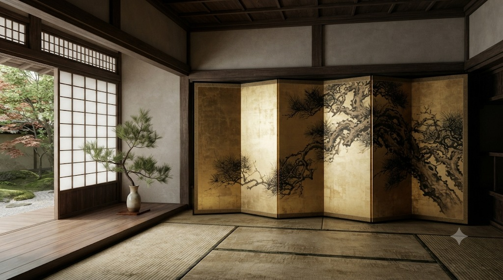

# 도파민성애자 | 그림 앞에 서는 대신 그림 안에 선다, 마루야마 오쿄의 공간 실험

**발행: 2026년 11월 20일 | 도쿄 전시 예정: 2026년 11월 28일~2027년 1월 24일 | 확인: 11월 20일 00:42 KST**

*기사의 내용을 표현한 3D 삽화. 실제 현장이나 제품을 재현한 사진이 아닙니다.*

## 아직 열리지 않은 전시를 읽는 방법

도쿄도 에도도쿄박물관은 11월 28일부터 특별전 '마루야마 오쿄, 리얼을 넘어 공간혁명'을 열 예정이다. 공식 안내에 따르면 120점 넘는 작품을 통해 초기부터 만년까지의 작업을 소개하고, 다이조지의 장벽화를 중심으로 회화와 공간의 관계를 다룬다. 이 기사는 개막 전 공식 기획을 읽은 프리뷰다. 전시장을 직접 보거나 작품 배치의 실제 효과를 확인한 관람평이 아니다.[1][2]

오쿄는 1733년에 태어나 1795년에 사망한 에도시대 화가다. 주최 측은 대상을 관찰해 그리는 사생을 중시한 작가이면서 한 폭을 넘어 공간 전체를 구성한 작가로 소개한다. 이 두 설명을 함께 읽으면 전시 제목의 '리얼'과 '공간'이 단순한 수식어가 아님을 알 수 있다.[1]

## 한 점의 그림과 여러 방의 그림

공식 소개는 효고현 다이조지에 전하는 165면의 장벽화군을 오쿄 예술의 중요한 성취로 설명한다. 이는 사찰에 전하는 작품군의 규모다. 165면 전체가 이번 도쿄전에 옮겨온다고 쓴 것이 아니다. 전시는 실제 장벽화와 함께 공작의 방·파초의 방·산수의 방 공간을 재현한다고 안내한다.[1][2]

여기부터는 해석이다. 액자 속 그림은 관람자가 정면에서 마주하는 물건이 되기 쉽다. 방을 둘러싼 그림은 관람자의 위치와 시선, 옆방으로 이동하는 경험까지 작품을 읽는 조건으로 만든다. 이번 전시의 흥미로운 질문은 '얼마나 닮게 그렸나' 다음의 '어디에서 보게 했나'다. 실제 전시가 그 경험을 얼마나 설득력 있게 구현하는지는 개막 후 확인해야 한다.

## 대표작 한 점 때문에 날짜가 달라진다

전시 전체 기간과 개별 작품 공개기간은 같지 않다. 공식 작품 안내에서 국보 '설송도 병풍'은 11월 28일~12월 6일의 한정 공개다. 전반기와 후반기에도 전시 교체가 있다. 전체 회기 중 아무 날에 가도 같은 작품을 볼 수 있다고 생각하면 계획이 틀어질 수 있다.[2]

도쿄전은 2027년 1월 24일까지로 안내돼 있지만 12월 25일~1월 1일에는 휴관한다. 월요일 휴관 원칙에 예외일과 별도 휴관일도 있으므로 방문 전 박물관의 최신 공지를 확인해야 한다. 이 기사에서는 표를 사거나 예약을 대신하지 않았으며, 가격과 실시간 입장 가능 여부도 확인하지 않았다.[1]

## 미술의 오래된 질문이 오늘의 화면과 만날 때

회화의 공간을 오늘의 몰입형 전시나 화면 경험과 비교해 볼 수는 있다. 다만 오쿄를 현대 기술의 선구자라고 단정하거나 서로 다른 시대의 제작 목적을 하나로 합칠 필요는 없다. 닮은 것은 관람자의 시선이 경험을 바꾼다는 질문이지, 기술이나 역사적 맥락 전체가 아니다.

이 프리뷰에서 권하는 관람의 관점은 간단하다. 작품 이름만 확인하지 말고 그림이 어떤 방과 시선을 전제로 했는지 살펴보는 것이다. 실제 전시가 문턱·모서리·거리의 감각을 어떻게 전하는지 본다면, 익숙한 '잘 그린 그림' 밖에서 다른 이야기를 만날 수 있다. 단, 그 경험에 대한 평가는 아직 남아 있다.

## 출처
[1] 특별전 공식 사이트, 개최 취지·도쿄 회기·휴관일·작가 소개. https://okyo2026-27.jp/
[2] 특별전 공식 '볼거리'·작품 안내, 출품 규모·방 재현·개별 공개기간. https://okyo2026-27.jp/highlight.html
