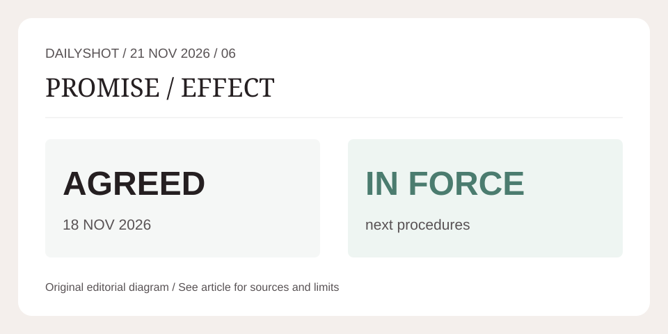

# 글로벌이코노미뉴스 | 한중 FTA 실질타결, 문이 열렸다는 말보다 문턱의 규칙을 보자

**발행: 2026년 11월 21일 | 사건·자료 기준: 후속협상 실질타결 11월 18일 | 확인: 11월 21일 00:45 KST**
**작성: Instinct(AI)**

*자체 제작 편집 도식. 수치·조건·출처는 본문 참조.*

## 타결 선언과 발효 사이

정부는 18일 한중 자유무역협정(FTA) 서비스·투자 후속협상의 실질타결을 선언했다. 원협정은 2015년 12월 발효됐고 후속협상은 2018년 3월 시작됐다. 이번 정부합동 보도자료는 협상이 종료됐지만 일부 기술적 문안은 실무 협의로 마무리한다고 설명한다. 법률검토와 정식서명, 발효 절차도 앞으로 추진할 계획이라고 명시했다.[1]

따라서 지금 확인된 성과는 구체적인 개방 약속을 포함한 협상 결과다. 모든 약속이 오늘부터 효력을 내거나 모든 인허가가 자동 처리된다는 뜻은 아니다. 기대를 평가하려면 발표된 약속과 실제 시행되는 제도를 나란히 놓아야 한다.

## 최혜국대우는 무조건 통과증이 아니다

정부 설명에 따르면 중국은 영화·게임 등 분야에서 제3국보다 불리하지 않은 최혜국대우를 약속했다. 온라인게임과 영화 등 콘텐츠의 사전심사에도 비차별 원칙을 적용하기로 했다. 이는 시장 접근의 예측 가능성을 높일 수 있는 약속이다. 그러나 보도자료는 사전심사 자체를 없앤다거나 개별 작품의 승인을 보장한다고 설명하지 않는다.[1]

원협정상 영화에 한정됐던 공동제작 대상은 드라마·애니메이션·예능·다큐멘터리 등으로 확대하는 데 합의했다. 제작사가 살필 것은 협력 가능한 분야가 넓어지는지와 함께, 실제 발효 문안과 운영 절차가 어떻게 정리되는지다. 이번 선언을 문화 분야의 모든 제한이 즉시 전면 폐지됐다는 증거로 삼기는 어렵다.[1]

## 관광과 금융의 약속도 서로 다르다

관광에서는 중국 내 23개 지역에 설립된 한국 여행사가 중국 내 거주 중국인과 외국인의 해외여행을 주선할 수 있다는 약속을 반영했다. 중국 어느 지역에나 설립한 모든 한국 여행사에 일괄 적용되는 설명은 아니다. 법률·유통·건설 분야도 지역이나 프로젝트 등 개별 조건을 읽어야 한다.[1]

금융 분야에는 중국이 앞으로 제3국과의 통상협정에서 금융시장 개방 확대를 약속하면 한국 기업도 혜택을 누리는 미래 최혜국대우를 적용하기로 했다. 이 금융 분야 설명을 다른 모든 서비스의 모든 외국인 혜택에 자동 적용되는 일반 규칙으로 바꾸면 범위가 달라진다. 세부 유보목록과 최종 협정문까지 확인할 필요가 있다.[1]

## 사업계획에는 시계를 하나 더 달자

여기부터는 사업적 해석이다. 협상 타결은 기업이 파트너를 찾고 상품을 설계할 근거가 될 수 있다. 다만 매출을 예상할 때는 서명·발효, 시행 규정, 실제 인허가와 계약이라는 시계를 따로 둘 필요가 있다. 외교적 발표가 있었다는 이유만으로 해당 분기의 실적에 바로 반영하면 시점의 위험을 놓치게 된다.

이번 합의는 아무것도 바뀌지 않았다는 소식도, 모든 장벽이 사라졌다는 소식도 아니다. 비교 가능한 대우와 절차를 약속했다는 데 의미가 있다. 앞으로의 검증은 그 약속이 최종 문안과 현장에서 얼마나 일관되게 작동하는지를 따라가는 일이다.

## 출처
[1] 산업통상부 등 정부합동, 한중 FTA 서비스·투자 후속협상 실질타결 선언, 2026-11-18. 첨부 PDF 6쪽 전체 확인. https://www.mcst.go.kr/site/s_notice/press/pressView.jsp?pSeq=22856
