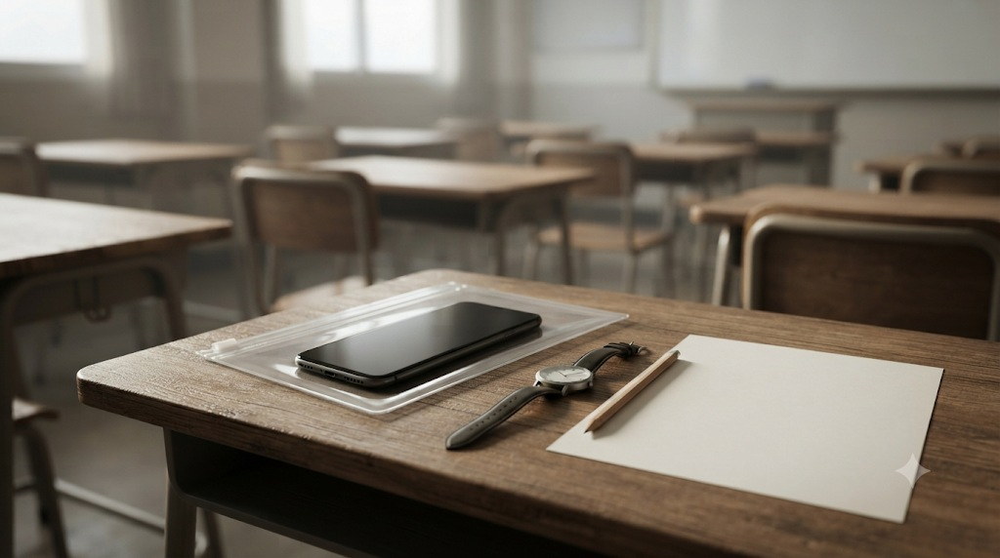

# 라이프人정글 | 수능 전자기기 111건, 실제 활용 5건: AI 부정행위로 뭉뚱그리지 말자

**발행: 2026년 11월 21일 | 사건·자료 기준: 교육부 11월 20일 집계 발표 | 확인: 11월 21일 00:45 KST**
****

*3D 삽화. 실제 사건·제품·인물의 사진이 아닙니다. 수치·조건·출처는 본문 참조.*

## 같은 표 안에 다른 종류의 사건이 있다

교육부가 20일 발표한 수능 전자기기 관련 부정행위 적발은 총 111건이다. 이 숫자를 'AI로 시험을 본 111명'으로 바꾸면 발표에 없는 사실을 보태게 된다. 원본 첨부는 위급재난문자와 관련된 스마트기기 적발 54건, 문자와 관계없는 적발 52건, 스마트기기를 활용한 부정행위 5건을 구분한다.[1]

실제 활용 5건의 세부 내역은 스마트안경 사용 1건, 소형 카메라·무선이어폰 사용 1건, 스마트폰으로 문제 촬영 1건, 화장실에서 스마트폰 사용 2건이다. 이 항목들의 존재만으로 각각 AI 모델이 답을 생성했는지, 외부 공모자가 있었는지까지 확인되는 것은 아니다. 교육부도 세부 물품과 부정행위 유형은 추가 분석·확인 중이라고 밝혔다.[1]

## 적발 경로와 행위 내용은 다르다

위급재난문자 관련 54건은 기기를 발견하게 된 경로와 관련된 집계다. 발표에는 세 차례 문자 시각별 적발 건수가 31건·11건·12건으로 나뉘어 있다. 문자가 왔다는 사실은 휴대·보관 규정의 문제를 드러낼 수 있지만, 그 사실만으로 시험 문제를 검색하거나 답안을 전송했다는 행위까지 증명하지는 않는다.[1]

이 구분은 규정 위반을 가볍게 보자는 뜻이 아니다. 금지된 기기의 소지·보관 문제와 기기를 이용해 답을 구하는 행위는 모두 엄정하게 다룰 수 있다. 다만 무엇을 했는지 정확히 적어야 어떤 예방책과 확인 절차가 필요한지 논의할 수 있다.

## 어제보다 늘어난 숫자를 어떻게 읽을까

교육부는 전날 발표 수치가 4교시까지 취합된 잠정 집계였다고 설명했다. 이후 5교시까지 각 시험장의 추가 보고와 확인 결과가 반영되면서 건수가 늘어났다는 것이다. 잠정 집계와 후속 집계의 차이를 곧바로 은폐나 급증의 증거로 읽을 근거는 이 자료에 없다.[1]

이번 발표의 단위는 적발 '건'이다. 같은 숫자를 곧바로 서로 다른 학생 111명으로 바꾸기보다는 원자료가 사용한 단위를 유지하는 편이 정확하다. 전체 응시자 수와 전년도 동일 기준 자료를 함께 대조하지 않은 상태에서 부정행위율이 얼마나 증가했다고 계산하는 것도 피해야 한다.

## 기술 대책보다 먼저 필요한 분류

여기부터는 정책을 보는 해석이다. 기기 반입을 줄이는 안내, 시험장 보관 절차, 실제 통신·촬영을 발견하는 대응은 서로 다른 문제를 다룬다. 사건을 모두 'AI 부정행위'로 묶으면 화려한 기술 대책이 먼저 떠오르지만, 실제 자료가 보여주는 취약점과 맞지 않을 수 있다.

학생 개인의 의도와 행위를 단정하기 전 확인할 자료도 남아 있다. 이번 집계는 현황 보고이지 개별 사건의 조사기록 전체가 아니다. 기술에 대한 공포가 숫자의 의미를 대신하지 않도록, 소지·적발·활용·AI 사용을 서로 다른 칸에 놓는 것이 먼저다.

## 관련 영상과 함께 읽기

YTN은 교육부의 추가 집계를 전하며 전자기기 관련 부정행위 적발이 전날 오후 5시 기준 98명에서 13명 늘어 111명이 됐고, 위급재난문자 관련 스마트기기 적발 54명, 문자와 무관한 소지 적발 52명, 실제 활용 부정행위는 5명에서 늘지 않았다고 보도했다. 실제 응시자 약 49만7천 명의 0.02% 수준이며 최종 징계는 12월 11일 성적 발표 전 심의위원회에서 정해진다. 잠정 집계가 후속 확인으로 늘어난 경위까지 방송문으로 확인돼, 숫자의 증가를 곧바로 은폐나 급증으로 읽을 수 없다는 본 기사의 지적과 같은 경위다. 영상은 인원을 명으로 표현하고, 본문은 교육부 원자료의 건 단위를 유지한다. 0.02%는 전체 111건에 관한 비율이며 실제 활용 5건의 비율을 뜻하지 않는다.

[관련 영상 YouTube에서 보기](https://www.youtube.com/watch?v=yPcuSoL4Ky4)

## 출처
[1] 교육부, 스마트기기 등 전자기기 관련 부정행위 적발 현황, 2026-11-20. HWPX 첨부 원문 전체 확인. https://www.moe.go.kr/boardCnts/viewRenew.do?boardID=294&boardSeq=107732&lev=0&m=020402&opType=N&page=1&s=moe&searchType=null&statusYN=W
