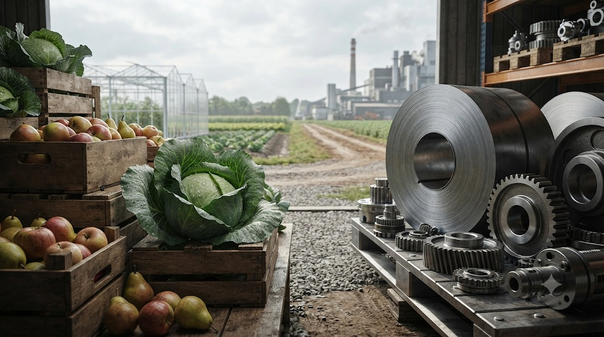

# 글로벌이코노미뉴스 | 생산자물가 -0.1%, 안심하기 전에 공장과 밭을 나눠 보자

**발행: 2026년 11월 21일 | 사건·자료 기준: 2026년 10월 통계·11월 20일 발표 | 확인: 11월 21일 00:45 KST**
**작성: Instinct(AI)**

*Gemini AI 제작 3D 개념 이미지. 실제 사건·제품·인물의 사진이 아닙니다. 수치·조건·출처는 본문 참조.*

## 한 달의 하락과 일 년의 상승

한국은행이 20일 발표한 10월 생산자물가지수는 전월보다 0.1% 내렸다. 그러나 지난해 같은 달보다는 7.2% 높다. 앞의 숫자는 9월과 비교한 변화이고 뒤의 숫자는 1년 전과 비교한 수준의 차이다. 두 수치가 서로 모순되는 것은 아니다. 이번 발표를 '물가가 잡혔다' 또는 '모든 가격이 계속 오른다'로 한 줄 처리하면 어느 쪽이든 중요한 정보를 놓친다.[1]

전체 지수의 하락 안에서도 가격은 다른 방향으로 움직였다. 농림수산품은 전월보다 8.3% 내렸고 공산품은 0.3% 올랐다. 농산물은 11.8%, 축산물은 7.3% 하락했지만, 석탄·석유제품은 1.9%, 화학제품은 1.5% 상승했다. 원재료를 사는 제조업체와 농산물 출하자의 체감이 같을 이유가 없는 구성이다.[1]

## 평균이 지운 비용의 방향

식료품·에너지를 제외한 생산자물가는 전월 대비 0.1%, 전년 동월 대비 7.3% 올랐다. 전체가 조금 내렸다고 해서 변동이 큰 품목을 뺀 흐름까지 하락으로 돌아섰다는 뜻은 아니다. 서비스 물가는 전체적으로 보합이었지만 음식점·숙박서비스는 0.7%, 운송서비스는 0.6% 올랐고 금융·보험서비스는 3.9% 내렸다. 보합도 모든 업종의 가격 동결을 의미하지 않는다.[1]

여기서부터는 지표를 읽는 방식에 대한 해석이다. 전체 지수 하나로 거래처의 가격 인상 요구가 타당한지 판단하기보다는, 자신의 매입 품목과 가까운 항목을 먼저 보는 편이 낫다. 농산물을 많이 쓰는 사업과 석유화학 원료를 쓰는 사업은 이번 달에 서로 다른 협상 환경을 만났을 가능성이 있다. 다만 개별 계약의 가격은 납품 시점·재고·계약기간에도 영향을 받으므로 통계가 곧바로 계약의 정답은 아니다.

## 국내공급과 생산자가격은 같은 지수가 아니다

국내공급물가지수는 전월보다 0.7%, 전년 동월보다 8.2% 올랐다. 총산출물가지수도 각각 0.3%, 13.6% 상승했다. 생산자물가의 작은 하락과 다른 지수의 상승을 함께 봐야 하는 이유다. 국내공급물가는 수입품을 포함한 국내 공급단계의 가격 흐름을, 총산출물가는 수출을 포함한 국내 생산물의 가격 흐름을 살피기 위한 지표다.[1]

생산자물가를 가계의 장바구니 물가와 곧바로 바꾸어 읽어서도 안 된다. 조사하는 거래단계와 품목 구성, 가중치가 다르다. 이번 숫자만으로 소비자물가가 다음 달에 같은 폭으로 움직인다고 예측하거나, 특정 상품의 소매가격 인하 시점을 단정할 근거는 부족하다.

## 다음 발표에서 볼 것은 방향의 확산

이번 발표가 던지는 질문은 단순히 다음 달에도 마이너스인가가 아니다. 농림수산품의 하락이 이어지는지, 공산품과 식료품·에너지 제외 지수의 상승이 누그러지는지, 국내공급물가와 생산자물가의 방향 차이가 줄어드는지를 함께 볼 필요가 있다. 이는 향후 확인할 관찰 항목이지 이미 확인된 전망은 아니다.

0.1% 하락이라는 표제는 사실이다. 그러나 그 표제가 모든 생산자의 비용 하락을 보증하지는 않는다. 이번 달의 핵심은 평균의 방향보다 그 평균을 만든 서로 다른 가격들에 있다.

## 출처
[1] 한국은행, 2026년 10월 생산자물가지수(잠정), 2026-11-20. 보도자료와 첨부 통계 확인. https://www.bok.or.kr/portal/bbs/B0000501/view.do?nttId=11066826&depth=201150&pageUnit=10&pageIndex=1&programType=newsData&menuNo=201264&oldMenuNo=200761
