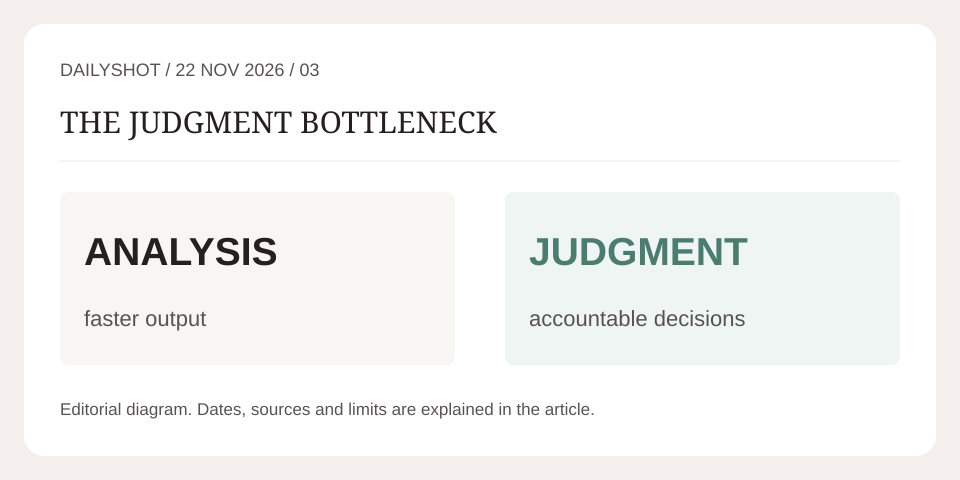

# 보고서는 빨라졌는데 결정은 왜 느려졌나

**데일리샷 매크로 리서치 | 회장님의 도박판(기업) | 2026년 11월 22일**

*편집 도식의 날짜·조건·출처는 본문 참조.*

**사건·자료 기준: 맥킨지 10월 15일 기고·11월 뉴스레터 재소개**

## 늘어난 산출물이 늘어난 성과는 아니다

분석 보고서를 만드는 시간이 줄면 경영도 빨라질까. 맥킨지가 10월 15일 공개한 전략 의사결정 기고는 꼭 그렇지 않다고 지적한다. 자료 수집과 시나리오 작성이 빨라져도, 가정을 이해하고 위험을 따지며 실행 책임을 정하는 속도는 같은 비율로 빨라지지 않기 때문이다. 11월 뉴스레터에 다시 소개됐지만 원문 발행일은 10월이다.[1]

기고는 AI가 분석을 가속할수록 사람의 판단이 새로운 병목이 될 수 있다고 설명한다. 보고서가 많아져도 출처와 가정을 알 수 없다면 임원은 결국 전부 다시 살펴야 한다. 빨라진 생산과 느려진 검토가 한 회사 안에 함께 나타날 수 있다는 주장이다.[1]

이 글은 특정 기업의 감사 결과나 AI 도입의 평균 수익률을 발표한 통계가 아니다. 맥킨지가 관찰과 사례를 바탕으로 제시한 경영 관점이다. 익명 사례의 배수를 전체 기업의 생산성 수치처럼 옮기지 않는 것이 중요하다.

## 검토 시간을 없애면 책임이 사라지는가

기고가 나누는 의사결정의 범위는 유용하다. 기준과 한계가 분명한 반복 업무, 불확실성이 큰 사업 판단, 인수합병·구조조정처럼 책임이 큰 결정은 같은 속도로 자동화할 대상이 아니다. 다만 앞의 업무도 사람이 정한 경계와 오류 처리 체계가 있어야 한다.[1]

여기서부터는 편집부의 해석이다. 경영자가 보고서 전체를 다시 읽는 일을 줄이려면 단순히 요약 분량을 줄이는 것으로 부족하다. 어떤 숫자가 사실이고 어떤 가정이 결과를 바꾸는지, 무엇이 틀리면 결정을 되돌려야 하는지를 앞에 놓아야 한다. 읽는 양을 줄이는 것과 책임질 수 있는 근거를 줄이는 것은 다르다.

회의용 자료의 첫 장에 결론만 적는 대신 핵심 가정과 미확인 사항, 결정권자가 선택해야 할 항목을 나란히 두는 방식이 한 예다. 이는 모든 회사에 입증된 단일 처방이 아니라 판단 부담을 어디에 배치할지에 관한 제안이다. 산업과 위험 수준에 따라 다른 설계가 필요하다.

## 신입의 시간을 줄일 때 사라지는 훈련

맥킨지는 또 하나의 비용을 짚는다. 초급 분석가가 자료를 모으고 모형의 오류를 고치는 일은 단순 반복이면서 동시에 판단력을 익히는 과정이었다. 그 일을 통째로 없애고 완성된 답만 받게 하면, 나중에 더 어려운 결정을 맡길 사람의 훈련 기회가 줄어들 수 있다는 것이다.[1]

그래서 교육은 도구 사용법만으로 끝나기 어렵다. 원자료와 결과를 비교하고, 계산과 가정을 설명하며, 틀린 결과를 고치는 경험이 필요하다. 보고서가 빨리 나왔다는 사실은 작성자가 그 내용을 이해했다는 증거가 아니다. 기고는 구조화된 도제식 훈련과 책임 주체의 지정을 제안한다.[1]

이 논리는 AI를 쓰지 말자는 주장이 아니다. 사람이 이해할 기회를 없앤 뒤 더 많은 판단을 맡기는 모순을 피하자는 것이다. 같은 예산으로 자료를 더 많이 만드는 것보다 조직이 검토하고 실행할 수 있는 결정을 더 잘 만드는 것이 중요하다.

## 이사회의 새 질문

관련 인터뷰 영상은 AI 파일럿이 실제 가치로 이어지는 데 업무 영역·데이터·인재·운영 방식이 함께 바뀌어야 한다는 관점을 제시한다. 아래 영상은 10월 기고를 그대로 읽은 영상이 아니라, 실행 병목을 비교해 볼 별도의 인터뷰다.[2]

경영자가 다음 회의에서 물을 것은 생성한 보고서가 몇 개인가만이 아니다. 의사결정의 질을 누가 검증했는지, 오류가 나면 누가 책임지는지, 후배가 무엇을 배웠는지다. 분석의 속도는 도입 성과의 한 부분일 뿐, 회사의 판단 능력 전체는 아니다.

## 함께 볼 영상

McKinsey: Why Agentic AI Pilots Stall. AI 도입이 실행 성과로 이어지는 조건을 다룬 관련 인터뷰다. 위 기고의 공식 영상판으로 소개하지 않는다.

https://www.youtube.com/watch?v=6FZOBMMJhEU

## 출처와 확인 범위

[1] McKinsey, The judgment bottleneck: Balancing AI and human speeds in strategy, 2026-10-15. 전체 원문 확인, 익명 사례를 일반 통계로 확대하지 않음. https://www.mckinsey.com/capabilities/strategy-and-corporate-finance/our-insights/the-judgment-bottleneck-balancing-ai-and-human-speeds-in-strategy

[2] 관련 공개 인터뷰, McKinsey: Why Agentic AI Pilots Stall. 반환된 대본에서 업무영역·데이터·인재·운영 방식의 결합 논의 확인. 영상의 개별 수익 배수는 인용하지 않음. https://www.youtube.com/watch?v=6FZOBMMJhEU
