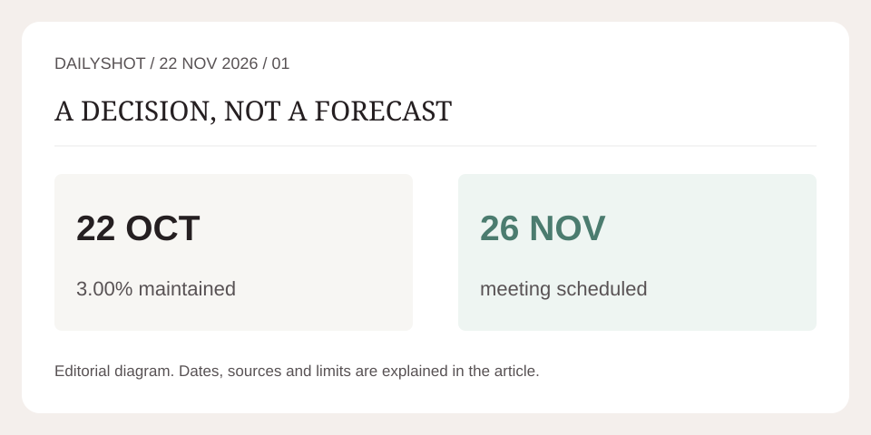

# 금리의 답보다 먼저, 11월 금통위에서 읽어야 할 세 가지

**데일리샷 매크로 리서치 | 경제 체온계(경제지표) | 2026년 11월 22일**

*편집 도식의 날짜·조건·출처는 본문 참조.*

**사건·자료 기준: 10월 22일 결정·11월 26일 회의 예정**

## 동결은 방향의 포기가 아니었다

한국은행의 올해 마지막 통화정책방향 결정회의는 11월 26일 목요일로 예정돼 있다. 날짜는 한은 공식 일정에서 확인된다. 아직 열리지 않은 회의다. 22일 일요일 현재 인상도 동결도 결과처럼 쓸 수 없다.[1]

출발점은 10월 22일 결정문이다. 금통위는 기준금리를 연 3.00%로 유지했고 위원 7명 모두 찬성했다. 그러나 같은 문서는 향후 추가 인상의 시기와 속도를 점검하겠다고 적었다. 만장일치 동결이라는 표결과 긴축 가능성을 열어 둔 정책 방향은 동시에 존재했다. 한 번 쉬었다는 사실을 인상 기조의 종료로 읽으면 다음 결정을 오해하기 쉽다.[2]

10월 결정의 이유도 단순한 경기 둔화가 아니었다. 한은은 수출과 투자의 높은 성장세, 높은 물가, 수도권 주택시장 등 금융안정 위험을 짚으면서도 중동사태와 주요국 정책의 불확실성, 앞선 두 차례 인상의 파급영향을 점검할 필요가 있다고 설명했다. 이는 당시의 판단이며 11월 회의가 그대로 반복된다는 보증은 아니다.[2]

## 첫째, 금리보다 문장의 조건을 읽는다

이번 회의에서 관찰할 첫 대상은 숫자 옆의 이유다. 금리가 같더라도 물가에 대한 평가가 강해지거나, 이전 인상의 효과를 더 기다려야 한다는 비중이 커지면 정책의 다음 질문이 달라진다. 반대로 인상이 나오더라도 그 뒤의 속도까지 자동으로 확정되지는 않는다.

이것은 예측이 아니라 읽기 순서에 대한 제안이다. 결정문에서 성장·물가·금융안정의 어느 항목이 바뀌었는지, 바뀐 설명에 어떤 조건이 붙는지를 먼저 비교해야 한다. 시장의 사전 예상과 실제 위원회의 결정을 구분하는 것도 기본이다. 21일 연합뉴스의 다음 주 전망은 인상 재개 관측을 소개했지만, 전망 기사는 의결문이 아니다.[3]

## 둘째, 성장률 전망과 체감경기를 나누어 본다

10월 결정문은 올해와 내년 성장률이 8월 전망치를 상당 폭 웃돌 것으로 예상했다. 그 근거로 반도체 경기와 수출·투자 호조를 들었다. 동시에 반도체 확장의 내수 파급 정도를 불확실성으로 적었다. 성장률이 높아질 수 있다는 전망과 그 성장이 가계와 업종에 얼마나 넓게 전달되는가는 다른 질문이다.[2]

26일에는 수정 경제전망도 예정돼 있다. 숫자가 상향되는지뿐 아니라 소비·수출·투자와 물가의 설명을 같이 볼 필요가 있다. 연간 전망이 좋아져도 모든 가계의 실질소득이 같은 폭으로 늘어나는 것은 아니다. 산업별·소득별 파급을 별도 자료로 확인해야 하는 이유다. 이 글은 아직 발표되지 않은 전망치를 미리 적지 않는다.[3]

## 셋째, 점도표는 약속이 아니다

연합뉴스는 이번 회의에서 위원들의 6개월 뒤 금리 전망을 반영한 점도표가 제시될 예정이라고 보도했다. 미래 경로에 대한 정보를 읽는 자료지만, 조건이 바뀌어도 그대로 지켜야 하는 계약은 아니다. 숫자의 분포와 그 전제에 관심을 둘 필요가 있다.[3]

가계나 기업이 할 수 있는 준비도 특정 결정에 한 번에 베팅하는 것과 다르다. 자신이 가진 계약의 금리 재산정 시점과 현금 지출 일정부터 확인하면, 기준금리 변화가 언제 실제 비용으로 들어오는지 분리해 볼 수 있다. 개별 대출을 받거나 투자상품을 고르라는 권유가 아니다. 정책의 시간과 계약의 시간이 다르다는 뜻이다.

이번 주의 핵심은 금리가 오르느냐를 먼저 맞히는 데 있지 않다. 무엇이 이미 확인된 판단이고 무엇이 아직 조건부 전망인지를 가려 읽는 데 있다. 26일 회의의 답은 그날 의결문과 설명이 나온 뒤 확인해야 한다.

## 함께 볼 영상

한국은행 「통화정책방향」 모두발언, 2026년 10월 22일. 11월 결정 영상이 아니라 비교를 위한 직전 회의 자료다. 반환된 영상 대본과 공식 결정문을 대조했다.

https://www.youtube.com/watch?v=Api3Y-gosT8

## 출처와 확인 범위

[1] 한국은행, 통화정책방향 결정회의 공식 일정. 2026년 11월 26일 확인. https://www.bok.or.kr/eng/main/contents.do?menuNo=400020

[2] 한국은행, 통화정책방향, 2026-10-22. 결정문 본문 확인. https://www.bok.or.kr/portal/bbs/P0000559/view.do?menuNo=200690&nttId=11065823

[3] 연합뉴스, 다음 주 경제, 2026-11-21. 회의·경제전망·점도표 예정 보도, 결과가 아닌 사전 전망. https://www.yna.co.kr/view/AKR20261121014700002
