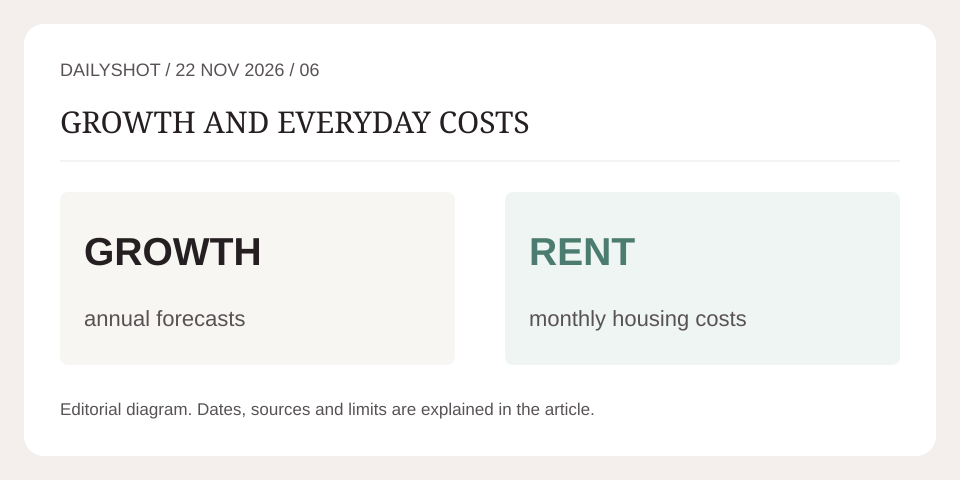

# 유럽은 왜 성장해도 불안한가

**데일리샷 매크로 리서치 | 돈 벌러 세계속으로(국제경제) | 2026년 11월 22일**

*프랑스의 재정, 독일의 제조업, 영국의 주거비에서 읽는 번영의 비용*

*편집 도식의 날짜·조건·출처는 본문 참조.*

유럽의 위기는 성장률 하나로 설명되지 않는다. 일자리가 있어도 집세를 감당하기 어렵고, 기업이 경쟁력을 지키려고 비용을 줄이면 지역의 고용과 세수가 흔들린다. 연금을 지키려는 요구와 연금을 떠받칠 재정을 마련해야 한다는 요구가 충돌한다. 경제가 조금 성장한다고 해서 이 갈등들이 저절로 사라지지는 않는다.

11월 19일 방송된 KBS 다큐 인사이트 「병든 거인, 위기의 유럽」은 프랑스의 연금과 재정, 독일의 자동차산업과 에너지, 영국의 주거·생활비를 따라간다. 이 기사에서는 영상이 보여준 현장과 최신 공공 자료를 나란히 놓았다. 영상의 사례를 유럽 전체의 통계로 확대하지 않고, 과거의 구조조정 계획을 오늘 확정된 실적으로 바꾸지 않는 것이 출발점이다.

이 글의 해석은 유럽이 단순히 복지를 많이 해서 흔들린다는 것이 아니다. 안정된 삶에 대한 약속과 그 약속을 뒷받침할 생산성·투자·주거 공급이 함께 움직이지 못할 때, 성장의 숫자와 생활의 체감이 벌어진다는 것이다. 리브랜딩을 계기로 세계경제를 읽는 방식도 여기서 다시 시작할 수 있다. 큰 숫자를 사람의 삶과 연결하되, 삶의 한 장면을 대륙 전체의 결론으로 삼지는 않는 방식이다.

## 1. '유럽 몰락'보다 먼저 확인할 것: 어느 유럽, 어느 시점인가

유럽은 유럽연합(EU)과 같은 말이 아니며 EU도 유로지역과 같지 않다. 이 다큐가 함께 다루는 영국은 2020년 1월 31일 EU를 탈퇴했다. 프랑스·독일과 영국의 사례를 연결해 유럽 사회의 공통 과제를 논할 수는 있지만, 같은 통화정책과 제도 아래 있는 세 나라처럼 취급해서는 안 된다.

출발 연도도 구분해야 한다. EU 단일시장은 1993년 출범했다. 유로는 1999년 장부상 통화로 도입됐고 지폐와 동전은 2002년 유통되기 시작했다. 유럽 통합의 이야기를 한 문장으로 줄이더라도 단일시장과 단일통화를 같은 사건으로 합치면 안 된다.

현재 경기와 장기 경쟁력도 다르다. EU 집행위원회의 2026년 11월 17일 가을 전망은 올해 EU 실질성장률을 1.4%, 유로지역을 1.2%로 예상한다. 독일은 1.3%, 프랑스는 0.4%다. 모두 연간 전망치이며 확정 실적은 아니다. 이 숫자는 유럽 전체가 지금 한꺼번에 마이너스 성장 중이라는 설명과는 맞지 않는다. 그렇다고 저성장과 산업 전환의 부담이 사라졌다는 뜻도 아니다.[1][2][3]

| 항목 | 최근 확인 수치 | 반드시 붙여 읽을 조건 |
| --- | --- | --- |
| EU 실질성장률 | 2026년 1.4% | 11월 17일 집행위 전망 |
| 독일 실질성장률 | 2026년 1.3% | 확정 실적 아닌 전망 |
| 프랑스 실질성장률 | 2026년 0.4% | 확정 실적 아닌 전망 |
| 프랑스 재정수지 | 2026년 GDP 대비 -5.5% | 집행위 전망 |
| 런던 평균 민간 월세 | 2026년 10월 2,350파운드 | 신규·기존 임대차를 함께 보는 ONS 지표, 잠정치 |
| 독일 가정용 전력요금 | 2026년 상반기 kWh당 약 0.36유로 | 산업용 전력가격과 다름 |

## 2. 프랑스: 연금을 줄일 것인가보다 넓은 재정의 문제

다큐는 은퇴한 부부의 생활과 일하는 세대의 부담을 대비한다. 연금이 제공하는 안정은 실재하는 사회적 가치다. 동시에 일하는 사람과 은퇴자의 관계, 생산성, 세입과 지출의 조합이 바뀌면 같은 제도를 유지하는 비용도 달라진다.

다만 재정적자를 연금 하나의 결과로 돌릴 수는 없다. 집행위는 프랑스의 2026년 재정적자를 GDP 대비 5.5%로 전망하면서 성장 둔화와 세수 부진, 이자비용 증가를 함께 지적한다. 정부부채 비율은 119.2%로 예상한다. 연금 문제는 이 넓은 재정 제약 안에 있다.[3]

연금 개혁의 정치적 상태도 고정돼 있지 않다. 프랑스 의회 전문매체 퓌블리크 세나의 11월 17일 보도에 따르면, 상원은 2027년 사회보장재정법안 심의 과정에서 2023년 개혁의 시행을 다시 추진하는 수정안을 가결했다. 정부는 이에 반대했다. 이는 상원 심의 단계의 사실이지, 연금 제도 전체가 최종적으로 다시 바뀌었다는 뜻은 아니다.[4]

여기서 필요한 질문은 어느 세대가 양보할 것인가만이 아니다. 취업과 생산성을 어떻게 높일지, 어떤 세금을 누구에게 걷을지, 연금 외 지출과 이자비용을 어떻게 관리할지까지 묻는 것이다. 고령층과 청년층을 서로의 문제로 놓으면 같은 경제의 세입과 지출을 나누어 보게 된다.

## 3. 독일: 폭스바겐의 위기에서 숫자의 범위를 읽는 법

영상의 볼프스부르크는 공장과 도시가 하나의 생활권을 이루는 공간이다. 자동차기업의 비용 절감은 손익계산서의 개선일 수 있지만, 노동자와 식당, 협력업체에는 소득의 감소일 수 있다. 기업을 살리는 조정과 지역을 지키는 정책이 함께 필요한 이유다.

이 대목에서 가장 주의해야 할 것이 감원 숫자다. 그룹 전체와 Volkswagen AG는 다르고, 독일과 세계 전체도 다르다. 계획·노사합의·실제 감소 인원은 또 다른 개념이다.

2024년 12월 노사합의에 담긴 수치는 독일 사업장에서 2030년까지 3만5천 명 이상을 줄이는 계획이었다. 당시 로이터 보도도 이 합의와 고용보호 조항, 생산능력 축소를 함께 설명했다. 이를 곧바로 10만 명 해고 완료로 쓰거나 모든 공장 폐쇄가 확정됐다고 옮기는 것은 맞지 않는다.[5][6]

상황은 그 뒤에도 변했다. EU 산하 Eurofound의 11월 17일 갱신 자료는 2026년 그룹 차원의 세계 인력 조정 계획과 Volkswagen AG의 추가 1만2천 명 감축 계획을 구분해 기록하고 있다. 이들은 적용 대상과 기존 계획과의 관계가 달라 단순히 더해서 하나의 확정 해고 총계로 만들 수 없다. 폭스바겐의 11월 19일 발표는 2027~2028년 임금 동결과 수당 조정 등을 회사의 교섭 요구로 제시하며 11월 24일 협상 시작을 예고했다. 회사의 요구가 곧 노사합의는 아니다.[7][8]

따라서 독일 제조업에 대한 결론은 거대한 숫자 하나보다 정확한 상태 설명에 있어야 한다. 경쟁 압력은 커졌고 추가 비용 조정이 논의되고 있다. 그러나 누가, 어디서, 언제, 어떤 방식으로 줄어드는지는 각각 확인해야 한다.

## 4. 에너지: 비싼 전기는 사실이지만 원인은 하나가 아니다

Eurostat의 10월 30일 발표에 따르면 2026년 상반기 독일 가정용 전력요금은 kWh당 약 0.36유로였다. 아일랜드가 약 0.39유로로 가장 높았고 독일과 벨기에가 그 뒤를 이었다. 같은 기간 EU 평균은 약 0.28유로로 2025년 하반기 대비 2.2% 내려갔지만 2022년 에너지 위기 이전보다는 여전히 높았다.[9]

여기에는 두 가지 구분이 필요하다. 가정의 최종 전기요금과 기업이 부담하는 산업용 전기요금은 같은 지표가 아니다. 요금이 높다는 사실만으로 어느 정책 하나가 전체 상승분을 만들었다고 계산할 수도 없다. 연료 조달, 발전 구성, 세금과 부과금, 송전망, 계약이 가격에 반영되는 시차를 함께 보아야 한다.

드라기 전 ECB 총재가 2024년 유럽 경쟁력 보고서를 설명하면서 내놓은 처방도 단순한 에너지원 선택에 그치지 않았다. 전력망 투자와 인허가, 국가 간 연결, 청정에너지 확대와 비용의 소비자 전달을 함께 다뤘다. 에너지 전환이 장기적인 비용 절감으로 이어지려면 전환을 뒷받침하는 망과 자본이 필요하다는 문제다.[10]

## 5. 영국: 집값이 내려도 세입자의 생활은 나아지지 않을 수 있다

다큐 속 하우스보트와 푸드뱅크는 생활비 압박을 보여준다. 하지만 한 사람의 보트 거주를 영국 청년 전체의 주거 방식처럼 일반화해서는 안 된다. 전국적인 변화는 통계로 다시 확인해야 한다.

영국 통계청 ONS가 11월 18일 발표한 자료에서 10월 런던의 평균 민간 월세는 2,350파운드였다. 영국 전체 평균은 1,411파운드로 전년 같은 달보다 3.8% 올랐다. 이 지표는 신규 광고 매물만이 아니라 신규·기존 임대차를 함께 보는 지표이며 최근치는 수정될 수 있다.[11]

눈에 띄는 것은 런던의 매매가격과 임대료가 다른 방향으로 움직였다는 점이다. 같은 발표에서 런던의 9월 평균 주택가격은 전년 동월보다 3.5% 낮았다. ONS의 공식 지역 비교 자료는 런던 전체의 10월 월세가 전년 동월 2,265파운드에서 2,350파운드로 올랐다고 제시한다.[16] 매매는 9월, 임대는 10월이고 측정 대상도 다르므로 동일 시점·동일 주택의 가격을 직접 비교한 결과는 아니다. 다만 이 인접한 월의 공식 지표들은 집값 하락을 곧바로 세입자의 주거비 완화라고 부를 수 없다는 점을 보여준다.

주거비는 생활의 문제인 동시에 노동과 산업의 문제다. 일자리가 있는 곳에서 살기 어렵다면 이직과 취업의 선택도 좁아진다. 이 글은 유럽 경쟁력을 공장 생산성과 기술기업 숫자뿐 아니라, 그곳에서 일할 사람이 감당할 수 있는 생활비까지 포함해 읽어야 한다고 본다.

## 유럽의 다음 장면은 복지 축소만으로 정해지지 않는다

EU 집행위가 공개한 드라기 보고서의 진단은 생산성 둔화, 고령화, 높은 에너지비용, 세계 경쟁을 함께 묶는다. 보고서를 무조건적인 규제 폐지론으로 줄이는 것도 정확하지 않다. 드라기는 유럽의 혁신 생태계와 자본시장 통합, 공공투자, 교육과 성인학습을 함께 논의했다.[10][12]

프랑스의 재정, 독일의 제조업, 영국의 주거비는 같은 문제가 아니다. 하지만 이 기사가 제안하는 공통 질문은 있다. 안정된 삶을 지키는 제도와 새로운 부가가치를 만드는 투자를 어떻게 함께 유지할 것인가. 기업의 전환 비용이 특정 도시와 세대에만 쏠리지 않도록 누가 어떤 역할을 맡을 것인가.

성장률이 양수라는 이유로 불안을 부정해서도 안 되고, 거리의 불안을 이유로 유럽 전체가 무너졌다고 결론 내려서도 안 된다. 유럽은 하나의 실패 사례가 아니라 서로 다른 조정이 진행 중인 여러 경제다. 우리에게도 필요한 것은 어느 모델을 통째로 버리거나 따라 하는 일이 아니다. 생산과 분배, 산업과 생활의 연결이 어디에서 끊기는지 구체적으로 찾아보는 일이다.

## 함께 볼 영상

KBS 다큐, 「유럽의 번영을 지탱해 온 경제·사회 시스템은 왜 흔들리고 있는가? | 다큐 인사이트 - 병든 거인, 위기의 유럽」, 2026년 11월 19일 방송
https://www.youtube.com/watch?v=EXOeE_2Kqiw

영상의 현장 사례와 문제의식을 참고하되, 수치는 아래 자료의 기준일·범위·잠정 또는 전망 여부를 우선했다. 영상 전사에서 확인된 표현을 한국어 발언 그대로 직접 인용하지 않았다.

## 출처

[1] EU 집행위원회, 2026년 가을 경제전망, 11월 17일
https://economy-finance.ec.europa.eu/economic-forecast-and-surveys/economic-forecasts/autumn-2026-economic-forecast-shows-continued-growth-amid-higher-inflation_en
[2] EU 집행위원회, 독일 경제전망, 11월 17일
https://economy-finance.ec.europa.eu/economic-surveillance-eu-member-states/country-pages-including-country-reports/germany/economic-forecast-germany_en
[3] EU 집행위원회, 프랑스 경제전망, 11월 17일
https://economy-finance.ec.europa.eu/economic-surveillance-eu-member-states/country-pages-including-country-reports/france/economic-forecast-france_en
[4] Public Sénat, 프랑스 상원 연금 개혁 심의 보도, 11월 17일
https://www.publicsenat.fr/actualites/politique/le-senat-vote-la-reactivation-de-la-reforme-des-retraites-de-2023-contre-lavis-du-gouvernement
[5] Volkswagen Group, 2024년 12월 20일 노사합의 발표
https://www.volkswagen-group.com/en/press-releases/agreement-reached-volkswagen-ag-positions-itself-competitively-for-the-future-18911
[6] Reuters, 2024년 12월 20일 노사합의 정리
https://www.reuters.com/business/autos-transportation/main-points-volkswagens-deal-with-unions-german-sites-jobs-2024-12-20/
[7] Eurofound, Volkswagen 구조조정 기록, 2026년 11월 17일 갱신
https://apps.eurofound.europa.eu/restructuring-events/detail/300979
[8] Volkswagen Group, 2026년 임금교섭 요구 발표, 11월 19일
https://www.volkswagen-group.com/en/press-releases/2026-collective-bargaining-negotiations-volkswagen-ag-calls-for-significant-relief-in-labor-costs-20874
[9] Eurostat, 2026년 상반기 가정용 전력요금, 10월 30일
https://ec.europa.eu/eurostat/web/products-eurostat-news/w/ddn-20261030-2
[10] Mario Draghi, 유럽 경쟁력 보고서 유럽의회 설명, 2024년 9월 17일
https://commission.europa.eu/document/download/fcbc7ada-213b-4679-83f7-69a4c2127a25_en?filename=Address+by+Mario+Draghi+at+the+Presentation+of+the+report+on+the+future+of+European+competitiveness.pdf
[11] ONS, Private rent and house prices, UK: November 2026, 11월 18일
https://www.ons.gov.uk/economy/inflationandpriceindices/bulletins/privaterentandhousepricesuk/november2026
[12] EU 집행위원회, 드라기 보고서 소개
https://commission.europa.eu/topics/competitiveness/draghi-report_en
[13] EU 이사회, 유로 도입 시점
https://www.consilium.europa.eu/en/topics/the-euro/
[14] EU 이사회, 단일시장 출범
https://www.consilium.europa.eu/en/policies/the-eu-single-market-benefits-facts-and-figures/
[15] EU 이사회, 영국 탈퇴
https://www.consilium.europa.eu/en/brexit/

[16] ONS, Housing prices in Hackney, 런던 전체 비교 항목(런던 월세·전년 비교, 지역 자체 수치와 구분)
https://www.ons.gov.uk/visualisations/housingpriceslocal/E09000012/
