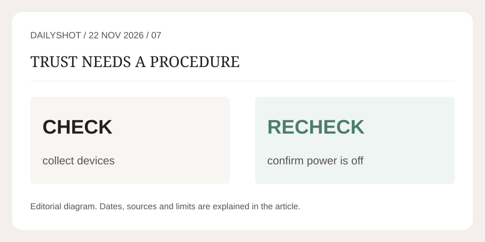

# 앞치마와 무작위 전화, 시험의 공정성은 어디까지 확인해야 하나

**데일리샷 매크로 리서치 | 라이프人정글(사회) | 2026년 11월 22일**

*편집 도식의 날짜·조건·출처는 본문 참조.*

**사건·자료 기준: 11월 21일 경비지도사 국가자격시험 현장**

## 전원을 껐다는 안내에서 확인과 보관으로

21일 경비지도사 국가자격시험 현장에서는 휴대전화 등 전자기기를 감독관이 직접 확인하고 일괄 관리하는 방식이 적용됐다. 고용노동부는 감독관이 전원 차단 여부를 살피고, 응시자에게 무작위로 전화를 걸어 다시 점검한다고 밝혔다. 김영훈 장관은 이날 서울 용산철도고를 찾아 준비 상황과 감독관 교육을 확인했다.[1]

이는 안내를 하는 것과 실제 이행을 확인하는 것 사이의 차이를 드러낸다. 기존 방식을 따르라는 문구가 있어도 기술과 부정행위 수법이 바뀌면 확인 절차가 달라져야 할 수 있다. 노동부는 19일 국가자격제도 종합점검 TF 첫 회의에 이어 현장 여건에 맞는 개선 대책을 준비하기 위한 점검이라고 설명했다.[1]

다만 한 시험에서 강화된 절차를 적용했다는 사실이 모든 국가자격시험에서 동일한 방식이 완전히 정착됐다는 뜻은 아니다. 이번 기사는 경비지도사 시험의 조치를 다룬다. 새 방식이 부정행위를 얼마나 줄였는지는 이후 점검과 평가가 필요한 별도의 문제다.

## 앞치마는 보이지만 운영의 품질은 잘 보이지 않는다

KBS와 연합뉴스는 옷 단추 등에 숨기는 초소형 카메라에 대응하기 위해 부직포 앞치마가 지급됐다고 보도했다. 노동부 원문도 앞치마 등 대응 상황을 점검했다고 밝혔다. 눈에 띄는 물품이어서 대책의 상징이 되기 쉽지만, 물품만으로 공정성이 완성되지는 않는다.[1][2][3]

감독관이 이상 징후를 어떻게 판단하는지, 시험본부와 어떻게 협의하는지, 응시자에게 같은 기준을 적용하는지가 함께 중요하다. 장관도 사소한 이상 행위라도 시험본부와 협의하고 감독관 교육을 포함한 개선을 준비하라고 지시했다.[1]

여기서부터는 편집부의 해석이다. 통제를 강화할수록 절차를 설명하는 능력도 중요해진다. 규정 준수를 요구받는 응시자가 어떤 기기를 어떻게 맡기고 언제 돌려받는지 명확히 이해할 수 있어야 한다. 공정한 시험은 적발의 엄격함과 절차의 예측 가능성을 함께 갖춰야 하기 때문이다.

## 의심의 확대와 검증의 정교함은 다르다

AI를 이용한 부정행위가 알려졌다고 모든 응시자를 잠재적 가해자로 취급할 수는 없다. 문제를 막기 위한 합리적 확인과 근거 없는 의심을 넓히는 일은 구분해야 한다. 확인되지 않은 개인의 행동을 온라인에서 단정하는 방식은 시험 제도의 신뢰를 높이지 못한다.

이번 공식 자료가 강조하는 것은 기기의 직접 확인과 공동 관리, 감독관 교육과 현장 점검이다. 수험생 전체에 대한 처벌 강화나 합격 취소가 새로 확정됐다는 내용으로 확대해서는 안 된다. 또한 다른 시험의 적발 건수와 이번 시험의 성과를 합쳐 하나의 통계로 만들지 않았다.

## 대책의 성과는 다음 기록에서 확인한다

앞으로 볼 것은 물품을 얼마나 나눠줬는지뿐 아니라 운영이 일관됐는지, 불편과 이의제기는 어떻게 처리됐는지, 새로운 수법에 대응할 감독 체계가 개선됐는지다. 이 항목들은 아직 결과가 아니라 향후 평가 질문이다.

기술이 바꾸는 것은 부정행위 도구만이 아니다. 시험을 관리하는 조직도 안내 중심의 관행에서 확인 가능한 절차로 움직여야 한다. 신뢰는 의심을 크게 만드는 말보다 같은 규칙이 실제로 작동했다는 기록에서 나온다.

## 함께 볼 영상

KBS News의 11월 21일 보도 영상. 반환된 대본과 노동부 원문에서 확인되는 조치를 대조했다. 새 방식의 효과가 이미 입증됐다는 영상으로 읽지 않는다.

https://www.youtube.com/watch?v=dALaNZOSyZY

## 출처와 확인 범위

[1] 고용노동부, 노동부 장관 국가자격시험장 현장 살핀다, 2026-11-21. 공개 원문 확인. https://moel.go.kr/news/enews/report/enewsView.do?news_seq=20285

[2] KBS, 무작위 전화·앞치마 지급…국가자격시험 점검, 2026-11-21. https://news.kbs.co.kr/news/pc/view/view.do?ncd=8719158

[3] 연합뉴스, 경비지도사 시험 현장 점검, 2026-11-21. https://www.yna.co.kr/view/AKR20261121023800530
