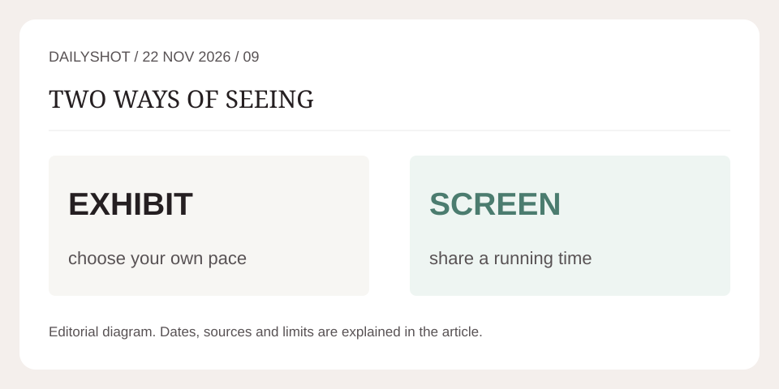

# 미술관에서 영화를 보는 이유, 전시와 기록 사이의 시간

**데일리샷 매크로 리서치 | 도파민성애자(문화) | 2026년 11월 22일**

*편집 도식의 날짜·조건·출처는 본문 참조.*

**사건·자료 기준: 11월 20일 프로그램 보도·10월 23일~2027년 2월 14일 전시**

## 작품을 보고 나온 뒤에도 남는 질문

전시는 작품 앞에 머무는 시간을 관람객이 고를 수 있다. 영화는 정해진 길이를 함께 지나가게 한다. 같은 공간에서 두 매체를 이어 보면 사회와 지역을 바라보는 방식도 달라질 수 있다. 전북도립미술관의 전시 연계 상영 소식은 이 차이를 생각하게 한다.

미술관 공식 전시 목록에는 「참여의 미술, 온다라미술관」이 본관에서 2026년 10월 23일부터 2027년 2월 14일까지 열리는 것으로 안내돼 있다. 20일 투데이안은 이 전시와 연계한 「전시를 잇는 스크리닝」 프로그램이 마련됐다고 보도했다. 황윤 감독의 다큐멘터리 「수라」와 조미혜 감독의 단편을 함께 소개하는 구성이다.[1][2]

20일 매불쇼 「시네마지옥」의 초반 대화에서도 짧은 영상 형식과 극장 상영을 오가는 이야기가 나왔다. 이는 특정 작품의 흥행을 입증하는 자료가 아니라, 작품의 길이와 상영 장소가 감상에 어떤 차이를 만드는지 묻게 하는 출발점이다. 이번 호는 전날 다룬 신작 평론을 반복하는 대신 그 질문을 미술관 상영으로 옮겨 본다.[4]

이번 기사는 프로그램을 직접 관람한 평론이 아니다. 공식 전시 목록, 프로그램 보도, 공개된 영화 예고편을 바탕으로 전시와 영화가 연결되는 방식을 읽는다. 참석과 관람을 경험한 것처럼 장면이나 관객 반응을 만들어 쓰지 않는다.

## 갯벌을 풍경이 아니라 시간으로 본다는 것

부산국제영화제가 공개한 「수라」 예고편은 갯벌과 생명, 사람들의 관찰을 전면에 놓는다. 짧은 예고편만으로 영화 전체의 논증과 미학을 판정할 수는 없다. 다만 아름다운 풍경을 소비하는 일과 변화하는 장소를 기록하는 일 사이에 질문이 있다는 점은 읽을 수 있다.[3]

투데이안은 「수라」가 군산 수라갯벌을 다룬 다큐멘터리이며, 전시 연계 프로그램이 지역의 삶과 생태·사회적 관계를 생각하는 자리라고 설명했다. 이는 프로그램의 소개와 기획 의도다. 특정 환경정책의 효과를 입증한 과학적 평가로 받아들일 수는 없다.[2]

여기서부터는 편집부의 문화적 해석이다. 반복해서 같은 장소를 관찰하는 기록은 개발 계획의 지도나 단 한 장의 사진이 놓치는 변화를 남긴다. 전시가 그 기록을 한눈에 펼쳐 놓는다면, 영화는 관람객에게 그 시간이 지나가는 속도를 견디게 할 수 있다. 두 매체를 함께 보는 가치는 같은 메시지를 두 번 받는 데만 있지 않다.

## 참여의 미술이 현재형이 되려면

사회에 참여하는 예술을 다루는 전시가 오늘의 지역 영화와 만나는 것은 과거의 운동을 보존하는 일과 현재의 질문을 이어 보는 선택이다. 오래된 작품을 연표 안에만 두면 그 시대의 사건으로 끝나지만, 지금의 공간과 사람을 다룬 영화 옆에 두면 무엇이 달라졌고 무엇이 남았는지 묻게 된다.

그렇다고 작품이 정책의 결론을 대신해 주는 것은 아니다. 예술은 무엇을 볼지 바꾸고, 놓쳤던 사람과 장소에 주의를 붙잡아 둘 수 있다. 법과 예산, 환경과 지역경제의 판단은 추가 자료와 토론을 요구한다. 감동을 받았다는 사실과 어떤 정책이 옳다고 입증됐다는 사실을 구분할 필요가 있다.

## 방문 정보와 비평의 범위를 나눈다

20일 보도는 11월 21~22일과 12월 5~6일 상영 일정을 소개했다. 그러나 본 기사에서 프로그램의 세부 시간과 잔여 관람 가능 여부까지 미술관에 직접 확인하지는 못했다. 방문하려면 미술관 공식 안내에서 당일 변경 여부를 다시 확인해야 한다. 이 글은 예약 가능성을 보증하는 행사 추천이 아니다.[2]

공식 목록에서 확인한 전시 기간과 보도된 상영 일정은 출처의 강도가 다르므로 함께 구분했다. 매체를 연결하는 기획이 흥미롭다는 평가가 실무적인 방문 정보 검증을 대신하지 않기 때문이다.

미술관에서 영화를 보는 이유는 스크린이 하나 더 있어서가 아니다. 작품을 보고 빠져나오는 자신의 속도에서 벗어나 타인의 기록이 흐르는 시간을 함께 지나는 데 있을 수 있다. 그 시간이 전시장 밖의 현실을 다시 보는 질문으로 이어지는지가 이번 기획을 읽는 가장 좋은 출발점이다.

## 함께 볼 영상

부산국제영화제가 공개한 「수라」 예고편. 현재 미술관 행사 소개 영상이 아니며, 전체 영화를 대신하는 자료도 아니다.

https://www.youtube.com/watch?v=XP2WEfZv9ak

## 출처와 확인 범위

[1] 전북도립미술관 공식 전시 목록, 참여의 미술 온다라미술관 전시 기간 확인. https://www.jma.go.kr/web/page.php?pcode=AA01&s_ecate=all&sel_topmonth=11&sel_topyear=2026

[2] 투데이안, 전시를 잇는 스크리닝 개최, 2026-11-20. 프로그램 구성·일정은 이 보도에 근거하며 당일 변동 여부와 관람 가능 인원은 미확인. https://www.todayan.com/news/articleView.html?idxno=638036

[3] 부산국제영화제, BIFF2022 수라 공식 예고편. 전체 영화 관람을 주장하지 않음. https://www.youtube.com/watch?v=XP2WEfZv9ak

[4] 최욱의 매불쇼, 2026년 11월 20일 영화 회차 25348185. 공개 음원 초반 영화 형식·극장 상영 대화의 전사 내용을 의미 검토. 전체 방송 완청이나 전체 영화 관람을 주장하지 않음. https://file.ssenhosting.com/data1/geesik02/261120b.mp3?cmad=2f64617461312f67656573696b30322f323631313230625f6133312e6d7033
