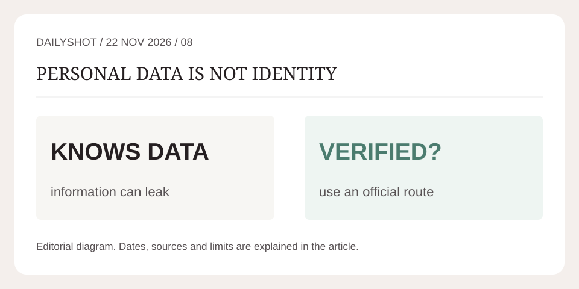

# 내 대출을 안다는 전화, 진짜 은행이라는 증거는 아니다

**데일리샷 매크로 리서치 | 마이다스의 Z-Tech(생활·금융) | 2026년 11월 22일**

*편집 도식의 날짜·조건·출처는 본문 참조.*

**사건·자료 기준: 10월 6일 경보·11월 6일 특별대응 연장 안내**

## 유출된 정보가 신뢰의 재료가 될 때

낯선 사람이 자신의 소득과 대출한도를 정확히 말하면 믿음이 생길 수 있다. 금융위원회의 10월 6일 소비자경보는 바로 그 지점을 경고했다. 유출된 개인정보를 조합하면 사기범도 정상적인 대출 상담처럼 접근할 수 있으므로, 정보를 알고 있다는 이유만으로 정상 연락이라고 판단해서는 안 된다는 것이다.[1]

금융당국은 이후 개인정보 유출 2차 피해 특별대응기간을 연말까지 연장했다. 금융위가 11월 9일 게시한 정책영상은 11월 6일 기준 조치를 설명한다. 22일 새로 발생한 유출사고 발표가 아니라 이미 시행 중인 대응과 소비자 행동요령을 다시 읽는 기사다.[2]

그 안내는 당시 이번 유출사고 관련 보이스피싱·스미싱으로 고객 자금이 유출된 사례가 보고되지 않았다고 설명했다. 이 문장을 22일 현재도 피해가 전혀 없다는 보증으로 바꾸지 않는다. 특정 시점의 집계와 앞으로의 위험은 다르기 때문이다.[2]

## 보상과 보호를 이유로 돈을 보내라는 요구

10월 소비자경보는 유출 피해 보상, 저금리 대환대출, 신용점수 상향 등을 앞세워 송금이나 악성앱 설치를 유도하는 수법을 설명한다. 특히 금융당국과 금융회사가 전화·문자로 비밀번호나 인증번호를 요구하거나, 계좌 보호와 피해 보상을 이유로 특정 계좌 송금을 요구하지 않는다고 안내한다.[1]

사기 여부를 가리는 핵심은 상대가 얼마나 많은 정보를 아는가보다 무엇을 요구하는가다. 기존 대출을 갚아야 한다며 개인 명의 계좌로 보내라고 하거나 보안점검을 위해 앱을 설치하라고 한다면, 상대방이 건네준 연락 경로 안에서 사실 확인을 끝내지 않는 것이 중요하다.

금융위는 유출 여부와 내용은 금융회사 공식 홈페이지·앱 또는 대표번호를 통해 직접 확인하도록 안내한다. 문자 속 주소와 전화한 사람이 알려준 번호 대신 독립적으로 공식 경로를 찾으라는 의미다. 이것은 피해를 당한 사람의 부주의를 탓하는 조언이 아니라, 이미 유출된 정보로 꾸며낸 친숙함을 끊는 절차다.[1]

## 안심차단은 무엇을 막는가

공식 안내는 여신거래, 비대면 계좌개설, 오픈뱅킹의 안심차단을 구분한다. 대출과 신용카드 발급 등을 막는 기능, 비대면 계좌개설을 막는 기능, 오픈뱅킹 조회·이체를 막는 기능의 대상이 같지 않다. 하나를 신청했다고 모든 금융사기를 막는다고 설명할 수 없다.[1]

당국은 거래 금융회사 영업점과 내계좌한눈에 또는 은행앱을 통한 신청 경로를 안내한다. 필요한 거래가 생겼을 때 해제 절차가 필요할 수 있다는 점도 함께 봐야 한다. 특정 차단 기능을 선택하기 전에 공식 안내에서 대상과 해제 방법을 확인해야 하며, 이 기사는 어느 독자에게 일괄 가입을 지시하는 내용이 아니다.[1]

금융회사 쪽의 대응도 있다. 유출 고객 전담창구, 이상거래탐지 강화, 고액 이체 때 본인확인, 금융권 공동 정보공유 등이 연장 조치에 포함됐다. 소비자 한 사람의 주의만으로 보안 책임을 대체할 수 없다는 뜻이다.[2]

## 피해가 발생했다면 확인보다 시간을 먼저 지킨다

실제로 속아서 돈을 이체하는 등 금전 피해가 생겼다면 금융위 안내는 즉시 경찰 112 또는 금융회사 콜센터에 연락해 지급정지를 요청하라고 설명한다. 상담을 찾는 일과 이미 나간 자금을 멈추기 위한 조치는 시간의 무게가 다르다. 지급정지 요청이 모든 피해액의 회수를 보장하는 것은 아니다.[1]

보안을 읽는 기준은 더 복잡한 공포가 아니다. 상대의 정보량과 신원을 구분하고, 요구된 행동을 확인하며, 문제가 생기면 공식 경로로 바로 연결하는 것이다. 내 정보를 안다는 사실은 내 돈을 맡겨도 된다는 증거가 아니다.

## 함께 볼 영상

금융위 공식 페이지에 연결된 「금융뉴스」 11월 6일 영상. 해당 시점의 특별대응 연장 설명이며 11월 22일 피해 현황 발표가 아니다.

https://www.youtube.com/watch?v=vPEyb2Zb4HY

## 출처와 확인 범위

[1] 금융위원회, 최근 금융권 개인정보 유출사고에 따른 피해 주의, 2026-10-06. 경고 수법·안심차단 범위·112 및 금융회사 지급정지 안내 확인. https://www.fsc.go.kr/no010101/87882

[2] 금융위원회, 개인정보 유출 특별대응 연말까지 연장, 2026-11-06 내용·11-09 게시. https://www.fsc.go.kr/no010107/88103
