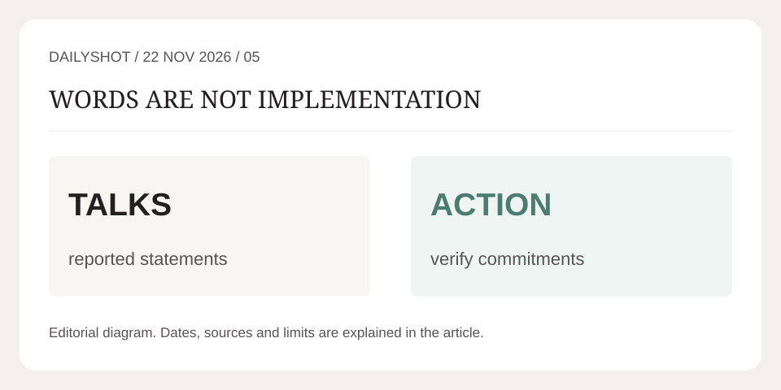

# 한반도를 논의했다는 말과 한반도 합의 사이

**데일리샷 매크로 리서치 | 여의도 한 입, 외교 한 접시(정치·외교) | 2026년 11월 22일**

*편집 도식의 날짜·조건·출처는 본문 참조.*

**사건·자료 기준: 11월 20일 방송 토론·11월 21일 후속 보도**

## 회담의 존재와 합의의 내용은 다르다

21일 KBS는 트럼프 미국 대통령이 미·중·러 정상회담에서 한반도의 위험에 대응하는 문제를 논의했다고 말했다고 보도했다. 그러나 그 위험의 구체적 의미와 어떤 대응이 논의됐는지는 설명하지 않았다고 함께 전했다. 논의했다는 발언이 확인됐다는 것과 구체적인 한반도 합의가 공개됐다는 것은 같은 사실이 아니다.[1]

이 차이를 지우면 두 종류의 과장이 생긴다. 하나는 세 나라가 한반도 문제를 이미 정리했다는 해석이고, 다른 하나는 아무것도 논의되지 않았다는 단정이다. 현재 확인한 보도는 그 사이에 있다. 미국 대통령의 설명은 있지만, 그것만으로 합의문·이행 일정·검증 장치를 재구성할 수는 없다.

## 핵 위험 감축과 핵무기 감축을 구분한다

KBS 보도에서 트럼프 대통령은 중국이 핵 위험을 줄이는 논의에 참여하기로 한 점을 성과로 제시했다. 반면 핵무기를 일률적으로 절반 줄이는 가정에는 난색을 보였다. 위험을 관리하는 대화와 실제 무기 감축의 규모·시한에 합의하는 일 사이에는 거리가 있다는 뜻이다.[1]

이 기사에서는 발언 중 세계 핵전력의 비중이나 향후 전력 추격 시점 같은 숫자를 독립된 확정 통계로 옮기지 않는다. 대통령이 제시한 수치를 검증된 군축 데이터와 혼동해서는 안 되기 때문이다. 현재 핵심은 큰 숫자의 인상이 아니라 무엇을 하기로 했는지의 범위다.

## 방송의 해석도 사실과 나란히 검토한다

20일 뉴스공장 겸손NSC 토론은 한국의 외교적 주도권과 균형외교를 주요 쟁점으로 다뤘다. 제성훈 교수는 회담을 세 나라가 세계를 분할할 수 있다는 증거보다 뚜렷한 주도국이 약해지는 변화로 읽었다. 이경렬 전 대사는 정상 간 만남 자체보다 한국이 남북대화의 장치를 만드는 노력이 중요하다는 관점을 제시했다. 이는 각 출연자의 평가이며 정부 간 합의를 확인한 문서가 아니다.[2]

토론 안에서도 평가의 초점은 같지 않았다. 어떤 출연자는 러시아가 얻는 외교적 지위에, 다른 출연자는 한국의 주도성과 대화 준비에 무게를 뒀다. 하나의 방송을 단일한 확정 결론으로 요약하기보다, 서로 다른 질문을 끌어내는 자료로 읽을 필요가 있다.

특히 방송에서 언급된 다른 나라의 의도와 비공개 외교 과정, 인물의 속내는 별도의 증거 없이 사실로 옮기지 않았다. 대담의 강한 표현은 논평의 성격을 보여주지만 증명의 강도까지 높여주지는 않는다.

## 한국의 질문은 참석 여부 뒤에 있다

여기부터는 편집부의 해석이다. 한국이 없는 자리에서 한반도가 언급됐다는 사실은 주의 깊게 볼 일이다. 다만 사진 속 자리나 한 문장의 언급만으로 외교의 성패를 판정하기보다는 이후 한국 정부의 설명과 협의, 북한의 반응, 실제 대화 채널의 변화를 확인해야 한다.

기업과 생활에 이어지는 위험도 경로별로 나눌 필요가 있다. 군사적 긴장, 제재와 교역, 에너지와 물류는 서로 연결되지만 한 번의 회담 발언만으로 모두 같은 방향으로 움직인다고 단정할 수 없다. 구체적 조치가 나오기 전에는 시나리오를 사실로 쓰지 않는 것이 합리적이다.

외교 뉴스를 읽는 순서는 만남, 발언, 합의, 이행이다. 이번 보도가 알려준 것은 앞 단계의 설명이다. 뒤 단계의 결론을 먼저 써놓지 않는 것이 한국의 선택지를 더 정확히 보는 길이다.

## 함께 볼 영상

SBS 8뉴스, 트럼프의 한반도 위험 논의 발언 관련 보도. 영상 대본을 읽고 KBS 후속 기사와 대조했으며, 세 정상의 공식 공동 합의문으로 소개하지 않는다.

https://www.youtube.com/watch?v=VAL7NcGYST4

## 출처와 확인 범위

[1] KBS, 트럼프 미·중·러 한반도 위험 논의 보도, 2026-11-21 21:10. 구체적 논의 내용 미공개 및 핵 감축 발언의 한계 확인. https://news.kbs.co.kr/news/pc/view/view.do?ncd=8719193

[2] 김어준의 겸손은힘들다 뉴스공장, 겸손NSC, 2026-11-20. 공개 대담 원문 중 제성훈·이경렬 등의 관점을 확인하고 논평으로 구분. https://humblefactory.co.kr/12684/
