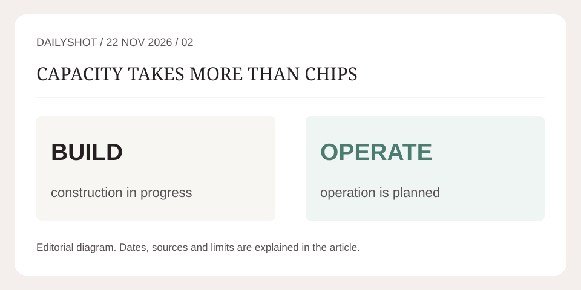

# GPU를 주문한 다음의 경쟁, 울산 데이터센터가 보여준 전력과 사람

**데일리샷 매크로 리서치 | 공장장 보고(산업·ICT) | 2026년 11월 22일**

*편집 도식의 날짜·조건·출처는 본문 참조.*

**사건·자료 기준: 11월 21일 현장 방문·운영 개시 계획**

## 건설현장의 질문이 산업정책이 되는 순간

21일 대통령의 울산 SK AI데이터센터 방문에서 나온 질문은 반도체 수요에 그치지 않았다. 건설 전문인력이 부족한지, 정전 때 비상발전기가 켜지기 전 전력 공백은 어떻게 메우는지까지 이어졌다. AI 인프라를 발표된 투자금이나 GPU 수량만으로 평가하기 어려운 이유가 여기에 있다.[1]

청와대 서면 브리핑에 따르면 이 시설은 2027년 말 운영 개시를 예정하고 있으며, SK그룹의 5GW급 AI데이터센터 구축 사업의 출발점으로 소개됐다. 현장소장이 설명한 공정률은 71%였다. 여기서 5GW는 그룹 사업 구상에 관한 수치이지 지금 울산에서 가동 중인 용량이 아니다. 공정률 역시 서버가 고객의 작업을 처리하는 상업운전 실적과 다르다.[1]

계획, 건설, 설비 반입, 시험, 운영은 서로 다른 상태다. 이 사이를 건너뛰면 정책 발표가 곧 매출이 되고, 공사 진척이 곧 사용률이 되는 잘못된 이야기가 만들어진다. 이번 기사는 현장 방문과 공식 발표를 확인한 것이며 완공·상업운전을 확인한 기사가 아니다.

## 3초를 연결하는 설비의 경제학

공식 브리핑은 비상발전기 전환에 약 3초가 걸리는 동안 UPS, 즉 무정전 전원장치가 전력을 공급할 수 있다는 현장 설명을 담았다. 이는 현장 관계자가 제시한 설계·운영 설명이다. 모든 장애가 실제로 검증됐거나 무중단 운영이 영구 보증됐다는 뜻으로 확대할 수는 없다.[1]

하지만 이 짧은 구간은 AI 인프라의 경제성을 읽는 좋은 출발점이다. 연산장비의 성능을 높여도 전력과 냉각, 운영 체계가 함께 작동하지 않으면 고객에게 제공할 수 있는 서비스가 줄어든다. 따라서 장비 구매 경쟁과 안정적으로 연산을 제공하는 경쟁은 같지 않다. 뒤의 경쟁에는 눈에 잘 띄지 않는 설비와 인력, 시험 시간이 들어간다.

이 대목은 편집부의 산업적 해석이다. 현장 브리핑만으로 해당 시설의 수익성이나 장애율을 계산할 수는 없다. 확인해야 할 자료는 완공 일정의 이행, 시험 통과, 전력 조달 조건, 고객 계약과 실제 사용률이다. 아직 공개 확인되지 않은 항목을 낙관적 전망으로 메워서는 안 된다.

## 지방 분산과 전력 경쟁력은 함께 증명돼야 한다

정부는 지방 중심 인프라 투자가 균형발전의 기회가 될 수 있다고 설명했다. 대통령은 장기적으로 안정적이고 저렴한 재생에너지 전력 공급이 산업경쟁력의 주요 요인이라고 강조했다. 이는 정책 방향과 기대다. 이번 방문 자체가 전력가격 인하나 지역 일자리 창출의 확정 실적은 아니다.[1][2]

지역 관점에서 물어야 할 것은 건설 때 생기는 일자리와 운영 때 남는 일자리의 차이, 필요한 전문인력을 어디에서 양성할지, 지역기업이 어떤 계약에 참여하는지다. 대형 시설 하나의 유치가 지역경제 전체의 자동 회복을 뜻하지 않기 때문이다. 성과를 판단하려면 투자액 외에 고용과 계약, 세수와 에너지 조달의 자료가 뒤따라야 한다.

## 속도 경쟁의 다음 지표

21일 현장에서 전문인력 부족 문제가 거론됐다는 점은 AI 경쟁의 병목이 칩 바깥에도 있음을 보여준다. 더 빨리 투자하는 나라와 더 빨리 안정적인 서비스를 제공하는 나라가 같은지는 따로 확인해야 한다.

울산에서 지금 확인된 것은 공사의 진행과 현장의 문제 제기다. 앞으로 볼 것은 그것이 계획된 운영으로 이어지는 과정이다. 이 순서를 지킬 때 AI 인프라는 구호가 아니라 실제 산업의 생산능력으로 평가될 수 있다.

## 함께 볼 영상

JTBC News의 11월 21일 울산 AI데이터센터 현장 영상. 반환된 대본에는 이름·설비 수치 오인식이 있어 정확한 숫자는 영상 자동대본이 아니라 공식 서면 브리핑을 기준으로 삼았다.

https://www.youtube.com/watch?v=gVN3cNJShPw

## 출처와 확인 범위

[1] 대한민국 정책브리핑, 울산 SK AI데이터센터 현장 방문 서면 브리핑, 2026-11-21. 운영 예정·5GW 구상·공정률·UPS 설명 확인. https://www.korea.kr/briefing/presidentView.do?newsId=148976223

[2] 연합뉴스, 울산 AI데이터센터 현장 방문, 2026-11-21. 현장 발언과 인력 문제 교차확인. https://www.yna.co.kr/view/AKR20261121033751001
