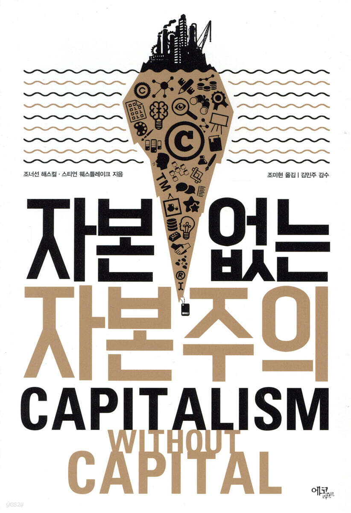

# Today's Book
## Why invisible assets can grow companies and widen gaps
A comparative reading of software, brands and training, starting from Capitalism without Capital

Culture | November 24, 2026

Cover source: YES24 product page. The existing reduced-size cover is retained to identify this edition. Copyright belongs to the rights holder; this does not mean that a general reuse licence has been verified.

[Korean edition at YES24](https://www.yes24.com/product/goods/61847765)

A business can grow without adding factories. Becoming physically lighter, however, is not the same as becoming less risky. Software, brands and organizational know-how can spread easily across locations, yet the investment may be hard to recover if things go wrong. This double edge is the starting point offered by Capitalism without Capital. This independent article compares the publicly available introduction and bibliographic information, different reviews and related research, then develops questions through hypothetical examples. It is neither a chapter-by-chapter substitute for the book nor a review claiming to have read it in full.

### Capital has not disappeared; its visibility has changed

The title does not promise businesses that need no capital. In the introduction published by Princeton University Press, the authors ask why money and time spent today to create future value can remain hard to see simply because the investment is not a physical object. Software, design, work processes and training require resources upfront, just as factories do.[1]

The introduction also explains measurement difficulties. There is not always a comparable transaction price, as there might be for used equipment, and the outcome remains uncertain before development is complete. Saying that invisible value exists differs from knowing exactly how much it is worth. Without that distinction, the book can become a slogan used to justify high valuations rather than a tool for analysis.[1]

Tangible and intangible assets do not merely displace one another. A 2012 OECD study argues that turning intangible opportunities into productivity requires labour and capital to move toward more productive uses. The more intangible ideas matter, the more it matters where the people and equipment needed to implement them are placed.[2]

“Investment” here is primarily an economic concept. Whether an expenditure qualifies for recognition as an accounting asset, and how it is treated for tax, are separate questions. Spending on training does not mean the same amount can automatically be counted as the company's asset value. Keeping these questions apart is the first safeguard in reading the book.

> Reading rule: do not treat an asset's existence, economic value, accounting recognition and market price as synonyms. The preceding paragraph is conceptual editorial explanation, not instructions for individual accounting treatment.

### The four S's are a framework for risks as well as opportunities

The book's distinctive framework is scalability, sunkenness, spillovers and synergies: the four S's. These are identified in YES24's publisher description and several independent reviews. They are not a law saying that all intangible assets behave alike, but a starting point for characteristics that questions centred on physical assets may miss.[1][3][4]

Scalability means that the same asset can be used repeatedly in multiple places. Easy replication does not mean acquiring customers is free. Even software offered to more users still requires operations and support. Sunkenness concerns difficulty recovering spending if things go wrong. It connects to the danger of justifying further spending because money has already been spent, but deciding what to check before failure is more important.

Spillovers mean that the investor cannot capture all the benefits. Others learning and using the knowledge can be socially beneficial diffusion, yet make it harder for the investor to recoup costs. Synergies mean that value changes when assets combine. Technology may become more valuable alongside distribution or trust, but the cost of managing the combination must also be questioned.

The Richmond Fed review notes the book's somewhat particular use of “sunkenness.” Rather than merely meaning expenditure incurred in the past, it emphasizes the difficulty of selling an asset tailored to one company elsewhere. Remembering that context is more useful than memorizing the term.[4]

> Editorial explanation: replicability does not mean zero cost, and intangible assets are not all impossible to resell. Conditions differ by asset.

### Spending the same budget on software, a brand or training

Suppose a hypothetical organization allocates the same budget to one of these three areas. The comparison is not a company example from the book or an observed investment result. It is an editorial thought experiment translating the four S's into questions. It invents no returns and focuses on the evidence needed to judge.

First, work software. A tool used across departments offers scope to scale, but code customized for one department may be difficult to transfer or sell. Benefits may depend on integration with existing data and workflows. Ask more than whether it was developed: examine actual use, migration costs, maintenance burdens and the conditions under which the system could be replaced.

Second, a brand. Can its name and trust extend across products, and do new customers understand it in the same way? Advertising expenditure is not proof that trust has grown. Repeat purchases or unsolicited recommendations can be observations used to test the hypothesis. Other influences must be considered before attributing results to the brand.

Third, training. Benefits can spread when one person's knowledge reaches colleagues. Training specific to a task differs from knowledge useful at other firms. People's capabilities should not be treated as objects owned by the company. Examine work quality, knowledge sharing and changing roles after training, without automatically interpreting employee mobility as a loss.

> Comparison: ask about use and integration for software, evidence of trust for brands, and transfer and application of capability for training. The three are not combined into a single score.

### Why a good idea may not be good collateral

How should assets be financed when they can spread widely if successful but are hard to sell after failure? Robert N. Farago's 2018 CFA Institute review connects intangible characteristics with uncertainty and explains the book's argument that equity may suit them better than debt that relies on collateral. This is not a prescription that equity financing is right for every company.[5]

Scalability and synergies may strengthen leading firms, but omitting the conditions makes that explanation premature. Outcomes may depend on who can absorb knowledge, whether competitors can enter, and whether infrastructure needed for combinations is accessible. The OECD study also links the realization of innovation opportunities to finance, competition, intellectual-property rights and resource reallocation.[2]

Protection and diffusion are not a simple contest between good and bad. Preventing copying may improve expected recovery of investment; knowledge that is too closed may prevent new combinations. This balance is a subject for investigation after reading, not something solved instantly by the term “four S's.”

The practical benefit is an order of questions, not a formula for choosing fashionable companies: what asset exists; who benefits; what can be recovered after failure; and who pays to combine it with other assets? With those questions, “invisible value” moves closer to a testable hypothesis.

> Investment caution: this article does not value a particular company, forecast returns or recommend a financial product. Its financing discussion introduces arguments in the sources.

### Explanatory power is not an explanation of everything

In Korea, Hankyoreh journalist Im Jong-up described the book's connection between growing intangible investment, inequality and stagnation. Kong Byung-ho's EToday column called it a practical book with the character of research surveying changes in the economy. These show its reception in 2018; they are not empirical diagnoses of today's economy or the views of every reader.[6][7]

Matthew Whittaker's 2018 review for the Society of Professional Economists praised the book for offering a perspective while acknowledging its limits. It also observed that some arguments were more convincing than others and that implementing policy proposals would not be simple. The reservations within the praise matter.[8]

Aaron Steelman of the Richmond Fed raised more specific questions. He found the connection between intangibles and secular stagnation among the book's ambitious but insufficiently clear claims, and questioned how increased public funding would gain agreement and be used effectively. He did not reject the whole book, instead recognizing its evidence and insights.[4]

The claims that intangibles matter, that their properties affect corporate behaviour, and that they cause macroeconomic stagnation require different levels of argument. Accepting the first does not automatically prove the final causal claim. This is the most important reading principle emerging from the comparison.

> Scope of reception: this compares published reviews by named Korean and overseas writers. It does not include a reader survey, large-scale review analysis or verification against the latest macroeconomic statistics.

### Five questions to keep after closing the book

What remains after the spending ends? Who can use that value, and who controls it? Can it be transferred or resold? What other assets are needed, and what do they cost? What evidence would show the expectation was wrong, and when should investment stop? This is an editorial checklist starting from the four S's, not a checklist quoted from the authors.

About the authors: YES24 introduces Jonathan Haskel as an economist researching productivity, innovation and intangible investment, and Stian Westlake through his former policy and research leadership at Nesta. Publisher and bookseller descriptions retain job titles from different dates, so this article uses career experience rather than asserting current appointments.[3][9]

Related broadcast: we checked the official 3ProTV Book Understanding episode in which book columnist Namgung Min discusses the book and its linked YouTube page. Comparisons between companies in the video title are not reused as established current rankings. This article is not a transcript or summary based on viewing the entire broadcast.[10]

Edition and rights: the bibliographic reference is the 384-page Korean edition published by Ecolivres on June 25, 2018, translated by Cho Mi-hyun and reviewed by Kim Min-ju. Its actual cover identifies the edition, with source and rights attribution. Seeing a cover or finding it supplied by a bookseller does not automatically secure all reuse rights. No charts or images of the book's text are reproduced. General permission to reuse the cover has not been verified; the existing article's reduced-size, credited use is retained.

> Independent article: the book's own concepts are briefly introduced and linked to the sources. Comparisons, judgment questions and analysis of differences between sources are newly written, not arranged as a substitute for the entire book.

### Previous edition

The [original article published at 07:09 on November 24, 2026](reports/2026-11-24/todays-book-original-0709.md) is preserved.

### Sources and reading scope

[1] Princeton University Press, public Introduction.
https://assets.press.princeton.edu/chapters/s11086.pdf
Author's publicly available excerpt. Used for the meaning of investment, measurement limits and tangible/intangible distinctions; no extensive reproduction.

[2] OECD, Andrews and de Serres, Working Paper 989 (2012).
https://www.oecd.org/content/dam/oecd/en/publications/reports/2012/09/intangible-assets-resource-allocation-and-growth_g17a21ac/5k92s63w14wb-en.pdf
Research report. Used for reallocation, finance, competition and intellectual-property conditions, not current statistics.

[3] YES24, Korean-edition bibliography, contents, author and publisher information.
https://www.yes24.com/product/goods/61847765
Bookseller source. Edition, author careers and four S's; rechecked November 24, 2026 in the original article.

[4] Richmond Fed, Aaron Steelman, From Industrial to Intangible (2018 Q1).
https://www.richmondfed.org/publications/research/econ_focus/2018/q1/book_review
Independent review. Sunkenness, reservations about stagnation arguments and implementation.

[5] CFA Institute, Robert N. Farago review, July 13, 2018.
https://rpc.cfainstitute.org/research/financial-analysts-journal/2018/capitalism-without-capital
Professional journal review. The book's arguments on uncertainty, collateral and finance.

[6] Hankyoreh, Im Jong-up, 2018 review on the future of capitalism and intangible assets.
https://www.hani.co.kr/arti/culture/book/851146.html
Newspaper review, Korean reception; updated October 19, 2019. The title's 99% is not used as a current empirical statistic.

[7] EToday, Kong Byung-ho reading column, July 16, 2018.
https://www.etoday.co.kr/news/view/1641844
Newspaper column. Practical assessment of the research-oriented book and inequality.

[8] SPE, Matthew Whittaker review, July 9, 2018.
https://spe.org.uk/reading-room/book-reviews/capitalism-without-capital/
Professional association review. Scope and policy implementation difficulties.

[9] Princeton University Press, original-edition description.
https://press.princeton.edu/books/ebook/9781400888320/capitalism-without-capital
Publisher source. Core argument and author identification; promotional statements are not independent assessments.

[10] 3ProTV official episode and linked YouTube page.
https://apps.3protv.com/episode/view/33840
Official broadcast. Matching the book episode and Namgung Min's appearance, not summarizing the entire discussion.
https://www.youtube.com/watch?v=O8U-8-cYD40
