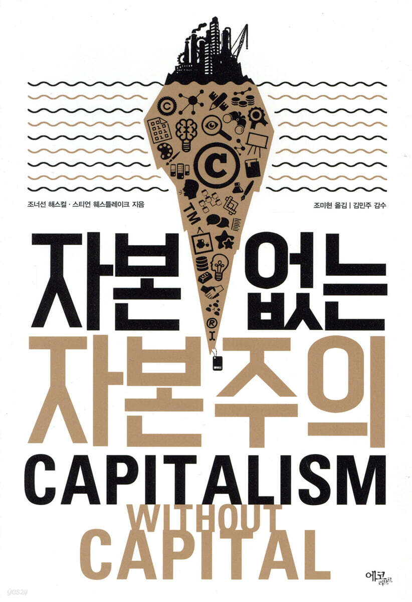

# Today's Book
## 見えない資産はなぜ企業を育て、格差も広げるのか
Capitalism without Capital（韓国語版『자본 없는 자본주의』）を起点に、ソフトウェア・ブランド・教育を比較する

文化 | 2026年11月24日

表紙出典：YES24商品ページ。版を識別するため既存の縮小表紙を維持した。著作権は権利者に属し、包括的な再利用許可を確認したという意味ではない。

[YES24韓国語版](https://www.yes24.com/product/goods/61847765)

工場を増やさなくても事業は成長できる。しかし身軽になることとリスクが減ることは同じではない。ソフトウェア、ブランド、組織のノウハウは各地に広げやすい一方、失敗すると投資を回収しにくい。この両面性が本書の出発点だ。本稿は公開序文、書誌、異なる書評、関連研究を比較し、仮想例で判断の問いを広げた独立記事である。本全体の代わりとなる章別要約でも、全巻読了をうたう書評でもない。

### 資本が消えたのではなく、見え方が変わった

書名は資本不要の事業を約束しない。プリンストン大学出版局の公開序文で著者が問うのは、今日の費用や時間が将来価値を生む投資なのに、物理的な物でないため見えにくくなる問題だ。工場だけでなく、ソフトウェア、設計、業務手順、訓練にも先に費用と時間が要る。[1]

序文は測定の難しさも説明する。中古設備のような比較可能な取引価格が常にあるわけではなく、開発前には結果も不確実だ。見えない価値があるという主張と、その価格を正確に知るという主張は違う。区別を失えば、本は分析道具ではなく高い企業評価を正当化する標語になりうる。[1]

有形と無形は互いを押しのけるだけではない。OECDの2012年研究は、無形資産の機会を生産性につなげるには、労働と資本をより生産的な用途へ再配分できる必要があるとする。無形のアイデアが重要になるほど、実現する人と設備の配置も重要になる。[2]

本稿の「投資」はまず経済的意味である。会計上の資産認識や税務処理は別問題だ。研修費を支払ったからといって、その額がそのまま企業の資産価値になるとは計算しない。問いを混同しないことが最初の安全策だ。

> 読む基準：資産の存在、経済価値、会計上の認識、市場価格を同義にしない。前段は概念を分ける編集解説で、個別会計処理の指針ではない。

### 4Sは成長公式でなく、機会とリスクを見る枠組み

本書独自の枠組みは、拡張性scalability、埋没性sunkenness、波及spillovers、相乗効果synergiesという4Sだ。YES24の出版社紹介や複数の独立書評で確認できる。すべての無形資産が同じという法則ではなく、有形資産中心の問いが見落とす性質を示す出発点である。[1][3][4]

拡張性は同じ資産を複数の場所で繰り返し使えることだ。ただし複製が容易でも顧客獲得費がゼロとは限らない。ソフトウェア利用者が増えても運営や支援は必要だ。埋没性は失敗時に支出を回収しにくい側面を指す。すでに使ったから追加投資するという判断への注意につながるが、失敗前に何を確かめるかがより重要になる。

波及は投資者が利益を独占しにくい性質である。他者が学び活用すれば社会には有益な知識拡散でも、投資者には回収の難しさになりうる。相乗効果は資産の組合せで価値が変わることだ。技術が流通網や信頼と結び付けば力を得られるが、その管理費用も問う必要がある。

リッチモンド連銀の書評は、埋没性という語の使い方がやや独特だと指摘する。単に過去に支出したことより、特定企業向けの資産を他に売りにくい点を重視する。用語以上に文脈を覚えたい。[4]

> 編集解説：複製可能は無費用を意味せず、無形資産がすべて転売不能でもない。資産ごとの条件を確認する。

### 同額をソフトウェア、ブランド、教育に使うなら

仮想の組織が同額予算を三つのいずれかに使うとする。これは本の企業事例や実績ではなく、4Sを問いに変える編集上の思考実験だ。架空の収益率は作らず、判断に必要な証拠に集中する。

第一は業務ソフトウェア。部署横断の共通利用は拡張につながるが、一部署向けコードは移転や販売が難しいかもしれない。既存データや業務との接続も必要になる。開発したかだけでなく、利用頻度、移行費、保守負担、システムを替えられる条件を確認する。

第二はブランド。名前と信頼を複数商品に広げられるか、新規顧客も同じ意味に受け取るかを問う。広告費は信頼蓄積の証拠ではない。再購入や自発的推薦を仮説の観察項目にできるが、他要因を見ずブランド効果と断定してはいけない。

第三は教育。一人の知識が同僚に伝われば便益は広がる。しかし特定業務向け訓練と他社でも使える知識は条件が異なる。能力を会社所有の物のように扱ってもいけない。仕事の質、知識共有、役割変化を調べ、従業員の移動を直ちに損失とみなさない視点が必要だ。

> 比較の要点：ソフトウェアは利用と接続、ブランドは信頼の証拠、教育は能力の移転と活用を問う。一つの点数には合算していない。

### 良いアイデアが良い担保とは限らない理由

成功すれば広く使える一方、失敗時には売りにくい資産をどう支えるか。CFA Institute掲載のRobert N. Faragoによる2018年書評は、特性と不確実性を結び、担保を期待する負債より株式による調達が適する可能性という本の論点を説明する。全企業に株式調達が正解という処方ではない。[5]

拡張性や相乗効果は先行企業を強めうるが、条件を省けば説明は早計だ。誰が知識を吸収できるか、競争者が参入できるか、組合せに必要な基盤が開かれているかで結果は変わる。OECDも金融、競争、知的財産権、再配分と革新機会を関連付ける。[2]

保護と拡散は単純な善悪ではない。複製の制限は回収期待を高めうる一方、知識が閉じすぎると新たな組合せを妨げる。この均衡は読後に調査すべき課題で、4Sという言葉だけでは解けない。

実用性は流行企業を選ぶ秘訣でなく、問いの順序にある。何の資産があり、誰が利益を得て、失敗すれば何を回収でき、他資産との組合せ費を誰が払うのか。この順序が「見えない価値」を検証可能な仮説に近づける。

> 投資上の注意：企業価値の個別計算、収益予測、金融商品推奨ではない。調達の部分は出典の論点紹介である。

### 説明力が高くても、すべてを説明しない

韓国のハンギョレ記者イム・ジョンオプは、無形投資の拡大と格差・長期停滞をつなぐ論点を紹介した。イートゥデイのコン・ビョンホのコラムは、時代の流れを見渡す研究書的な実用書と評価した。いずれも2018年の受容であり、現在の経済の実証診断や全読者の評価ではない。[6][7]

英国Society of Professional Economists掲載のMatthew Whittakerによる2018年書評は、一つの見方を示しつつ限界も認める点を評価し、同時に論証の説得力には差があり政策実施も簡単でないと指摘する。賛辞の中の留保も重要だ。[8]

リッチモンド連銀のAaron Steelmanは、無形資産と長期停滞の説明は野心的だが十分明確でなく、公的資金拡大の合意や効果的執行も不明だとする。一方で全体を否定せず、証拠と洞察を評価する。[4]

無形資産が重要という主張、その性質が企業行動に影響するという主張、マクロ停滞の原因という主張は、異なる段階の論証として読むべきだ。最初に納得しても最後の因果が自動的に証明されるわけではない。これが最も重要な読書原則になる。

> 反応の範囲：国内外の署名付き公開書評を比較した。読者調査、大規模レビュー分析、最新マクロ統計の検証は行っていない。

### 読後に残す五つの問い

支出後に何が残るか。誰が価値を使い統制するか。他へ移せるか、売れるか。結び付ける必要がある資産と費用は何か。何をもって予想が誤りと判断し、いつ止めるか。4Sを起点にした編集チェックリストで、著者の原文リストではない。

著者紹介：YES24はJonathan Haskelを生産性・革新・無形投資を研究する経済学者、Stian WestlakeをNestaの政策・研究責任者を務めた人物として紹介する。出版社と書店では異なる時点の肩書が残るため、現職は断定せず経験のみを用いた。[3][9]

関連放送：三プロTV公式Book Understandingで書評家ナムグン・ミンが本書を扱う回と、関連YouTubeページを確認した。動画題名の企業比較を現在の企業優劣の確定事実にしない。本稿は全発言録や全編視聴要約ではない。[10]

版と権利：情報はEcolivresが2018年6月25日に刊行した韓国語版384ページ、チョ・ミヒョン訳、キム・ミンジュ監修を基準とする。実表紙は版識別用で出典と権利者を明示した。書店が提供していても再利用権すべてが自動的に得られるとはしない。図表・本文画像は複製せず、包括的な表紙再利用許可は未確認で、既存記事の出典明示・縮小範囲を維持した。

> 独立記事として読む：固有概念は短く紹介し原文につなげた。事例比較、判断の問い、出典間の差の分析は新規執筆で、単行本全体の代替として構成していない。

### 旧版

[2026年11月24日07:09初版記事](reports/2026-11-24/todays-book-original-0709.md)を保存している。

### 出典と確認範囲

[1] Princeton University Press、公開Introduction。
https://assets.press.princeton.edu/chapters/s11086.pdf
著者公開抜粋。投資定義、測定限界、有形無形区分。長文転載なし。

[2] OECD、Andrews・de Serres、Working Paper 989（2012）。
https://www.oecd.org/content/dam/oecd/en/publications/reports/2012/09/intangible-assets-resource-allocation-and-growth_g17a21ac/5k92s63w14wb-en.pdf
研究報告。再配分、金融・競争・知的財産条件。現在統計として使わない。

[3] YES24、韓国語版書誌・目次・著者・出版社紹介。
https://www.yes24.com/product/goods/61847765
書店資料。版、著者経歴、4S。原記事は2026年11月24日再確認。

[4] Richmond Fed、Aaron Steelman、From Industrial to Intangible（2018 Q1）。
https://www.richmondfed.org/publications/research/econ_focus/2018/q1/book_review
独立書評。埋没性、停滞論証・政策実施への留保。

[5] CFA Institute、Robert N. Farago書評（2018年7月13日）。
https://rpc.cfainstitute.org/research/financial-analysts-journal/2018/capitalism-without-capital
専門誌書評。不確実性、担保、資金調達の論点。

[6] ハンギョレ、イム・ジョンオプ、2018年書評。
https://www.hani.co.kr/arti/culture/book/851146.html
韓国での受容。本文更新2019年10月19日。題名の99%を現在実証値に転用しない。

[7] イートゥデイ、コン・ビョンホ読書コラム（2018年7月16日）。
https://www.etoday.co.kr/news/view/1641844
新聞コラム。研究書的実用性と格差問題。

[8] SPE、Matthew Whittaker書評（2018年7月9日）。
https://spe.org.uk/reading-room/book-reviews/capitalism-without-capital/
専門家団体書評。範囲の評価、政策実行の難しさ。

[9] Princeton University Press、原書紹介。
https://press.princeton.edu/books/ebook/9781400888320/capitalism-without-capital
出版社資料。核心と著者表記の比較。宣伝を独立評価としない。

[10] 三プロTV公式回と関連YouTube。
https://apps.3protv.com/episode/view/33840
公式放送。書籍回と出演者の一致確認、全発言要約ではない。
https://www.youtube.com/watch?v=O8U-8-cYD40
