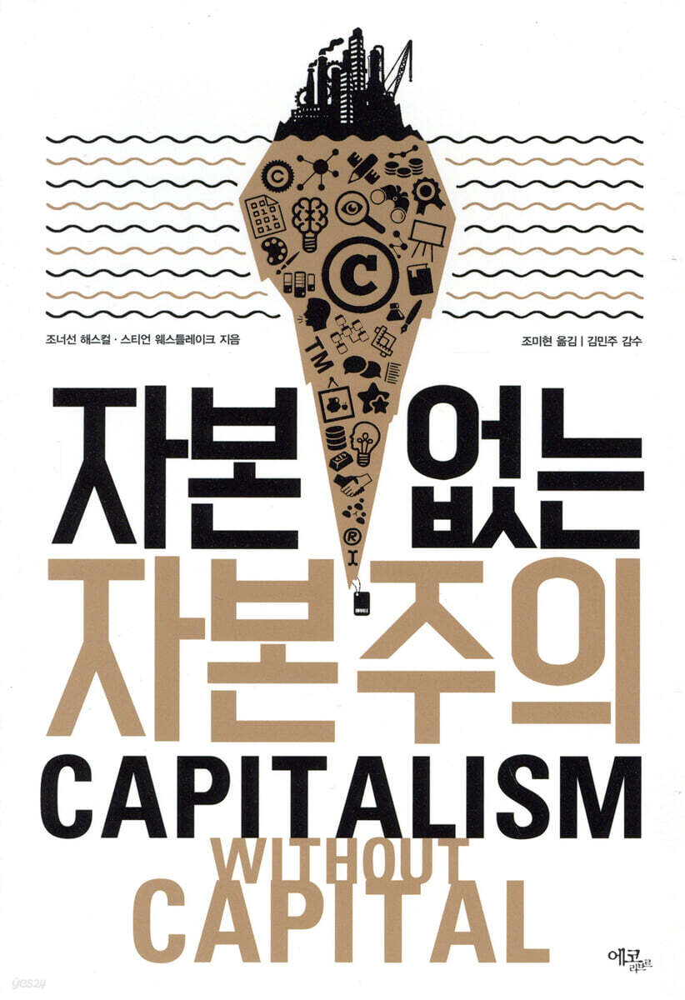

# Today's Book
## 공장은 보이는데 가치는 보이지 않는다
### 『자본 없는 자본주의』로 읽는 무형자산의 양면성

도파민성애자 | 2026년 11월 24일

<figure style="max-width:240px;margin:20px 0"></figure>
표지: 예스24 상품 페이지. 표지 저작권은 해당 권리자에게 있습니다.

조너선 해스컬·스티언 웨스틀레이크 지음 · 조미현 옮김 · 김민주 감수 · 에코리브르 · 2018.06.25 · 384쪽
[예스24 책 정보](https://www.yes24.com/product/goods/61847765)

기업의 가치를 공장과 기계만으로 읽을 수 있을까. 『자본 없는 자본주의』는 아이디어, 소프트웨어, 브랜드와 조직 같은 무형자산을 중심에 놓는다. 자본이 사라졌다는 선언이 아니라, 투자한 돈과 시간이 어떤 형태의 자산으로 남는지 다시 묻는 책이다. 2018년 한국어판을 지금 다시 읽는 기획이며 신간 소개는 아니다.

### 핵심은 네 가지 성질, 4S
한겨레의 2018년 서평과 예스24 출판사 소개는 무형자산을 확장성, 매몰성, 스필오버, 시너지라는 네 가지 특징으로 설명한다. 여러 곳에서 반복 활용하기 쉽지만, 사업이 실패하면 투자비를 회수하기 어렵다. 남에게 이익이 흘러갈 수 있고, 다른 자산과 결합하면 가치가 커질 수 있다. 이 네 성질은 무형자산을 무조건 좋은 투자로 만들지 않는다. 오히려 성장의 가능성과 손실의 위험을 함께 보게 한다.

### 두 서평이 함께 보는 기회와 격차
한겨레 임종업 기자의 서평은 무형 투자의 확산이 기업·도시·노동자 사이의 격차와 장기불황 위험으로 이어질 수 있다는 논점을 짚는다. 공병호가 이투데이에 쓴 2018년 7월 16일 독서 칼럼은 시대의 흐름을 조망하는 연구서 성격의 실용서로 평가하면서, 무형자산의 특성이 자금 조달과 불평등에 미치는 영향을 살핀다. 두 글 모두 성장의 이면에 있는 격차를 다룬다. 다만 이것은 두 필자의 당시 평가이지, 지금 독자 전체의 반응이나 현재 경제에 대한 실증 검증은 아니다.

### 남궁민의 방송과 이어 읽기
삼프로TV 공식 북언더스탠딩 페이지와 연결된 YouTube 회차에서 남궁민 북칼럼니스트가 이 책을 다루는 것을 확인했다. 방송 제목은 삼성과 애플의 차이를 전면에 내세우지만, 그 제목을 기업의 현재 우열을 증명한 결론으로 옮기지는 않는다. 이번 기사는 책의 개념과 신문 서평을 중심으로 구성했으며, 방송 전체를 시청한 요약이나 발언록은 아니다. 영상은 책으로 들어가는 별도의 경로로 제시한다.

### 저자를 짧게
예스24 소개에 따르면 조너선 해스컬은 생산성·혁신·무형 투자를 연구해온 경제학자다. 스티언 웨스틀레이크는 혁신재단 네스타에서 정책·연구 책임자를 지낸 인물로 소개된다. 두 사람의 오늘 직함을 단정하기보다, 이 책과 연결되는 연구·정책 경력을 소개한다.

### 오늘의 독서 질문
같은 돈을 설비, 소프트웨어, 브랜드, 직원 훈련에 쓴다면 무엇이 남고 무엇을 되팔 수 있을까? 이 질문은 책의 틀을 일상적 판단으로 확장한 편집적 질문이다. 특정 기업의 가치 평가나 투자 권유가 아니다.

예스24 서지·출판사 소개, 공개 서평과 공식 방송 정보를 비교한 글이며 완독 독후평이 아니다. 별도 독자 리뷰는 제시하지 않는다. 과거 서평의 경제 진단을 현재의 사실로 바꾸지 않았다.

출처
- 예스24 · 서지·목차·저자·출판사 소개 (2026.11.24 확인): https://www.yes24.com/product/goods/61847765
- 한겨레 · 임종업 서평 (2018년 기사, 본문 수정 2019.10.19): https://www.hani.co.kr/arti/culture/book/851146.html
- 이투데이 · 공병호의 독서산책 (2018.07.16): https://www.etoday.co.kr/news/view/1641844
- 삼프로TV · 남궁민 북언더스탠딩 공식 회차: https://apps.3protv.com/episode/view/33840
- 연결된 YouTube 영상 · 자본 없는 자본주의 1부: https://www.youtube.com/watch?v=O8U-8-cYD40
