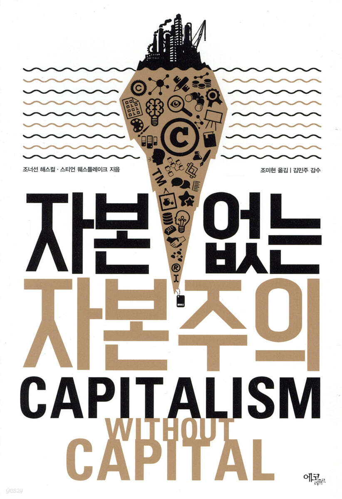

# Today's Book
## 无形资产为何既能壮大企业，也会扩大差距
从《Capitalism without Capital》（韩文版《자본 없는 자본주의》）出发，比较软件、品牌与培训

文化 | 2026年11月24日

封面来源：YES24商品页。保留原有缩小封面，用于识别该版本。版权属于相应权利人，不代表已确认一般性再使用许可。

[YES24韩文版](https://www.yes24.com/product/goods/61847765)

不增加工厂，企业也可能成长。但资产变轻，并不等于风险变小。软件、品牌和组织知识可以在多处使用，可是一旦失败，投入可能难以收回。这种双面性是本书提供的起点。本文比较公开导言、书目信息、不同书评及相关研究，再用假想案例延伸判断问题。它是独立文章，不是替代全书的逐章摘要，也不是声称完整读完的书评。

### 资本没有消失，只是呈现方式变了

书名并不承诺不需要资本的生意。在普林斯顿大学出版社公开的导言中，作者提出的问题是：今天投入金钱和时间以创造未来价值，为什么仅因它不是实体物品就难以看见？不只是工厂，软件、设计、工作流程和培训也需要先投入成本和时间。[1]

导言同时说明无形资产的计量困难。它不一定像二手设备那样有可比交易价格，开发完成前也无法确定会留下什么成果。“存在看不见的价值”与“准确知道它值多少钱”是两回事。忽略这一区别，本书容易从分析工具变成证明高估值合理的口号。[1]

有形与无形也不只是相互替代。OECD在2012年的研究指出，要把无形资产机会转化为生产率，需要使劳动和资本流向更有效率的用途。无形创意越重要，实现它的人和设备应放在哪里，也越重要。[2]

本文的“投资”首先是经济概念。某项支出能否确认为会计资产、税务上如何处理，是另外的问题。不能因为支付了员工培训费，就把同额支出直接算成公司资产价值。区分这些问题，是阅读本书的第一道防线。

> 阅读标准：资产存在、经济价值、会计确认和市场价格，不是同义词。上一段是概念区分的编辑解说，不是个别会计处理指引。

### 4S不是增长公式，而是同时观察机会和风险的框架

本书的特色框架是扩展性（scalability）、沉没性（sunkenness）、溢出（spillovers）与协同（synergies），即4S。YES24出版社介绍及多篇独立书评均提及这些概念。它们不是所有无形资产都一样的定律，而是提醒读者注意有形资产视角容易遗漏的性质。[1][3][4]

扩展性意味着同一资产能在多处反复使用。但容易复制不等于获取客户没有成本。软件服务更多用户，仍需运营和支持。沉没性是指失败后难以收回支出的方面；它与不能因已经花钱就为追加投资辩护有关，但更重要的是在失败前决定核实什么。

溢出意味着投资者难以独占全部收益。别人学习和使用知识，对社会可能是有益的传播，对投资者却可能增加回收成本的困难。协同意味着资产组合后价值会改变。技术与渠道或信任结合可能更有力量，同时也要追问管理这种组合的成本。

里士满联储书评指出，本书对“沉没性”的用法有其特点。重点不只是过去已经支出，而是为某一公司定制的资产难以转售他处。记住这一语境，比只记术语更有用。[4]

> 编辑解说：可复制不等于零成本，无形资产也不是全部无法转售。应逐项确认条件。

### 同样预算，用于软件、品牌还是培训

假设一个组织把相同规模的预算投向三者之一。以下并非书中企业案例，也非真实投资业绩，而是把4S转化成问题的编辑思想实验。不虚构收益率，只关注判断前需要收集什么证据。

第一是工作软件。多个部门共用工具有扩展空间，但只为某部门定制的代码可能难以出售或迁移。效果也可能依赖既有数据和流程。不能只问是否开发完成，还要看实际使用、迁移成本、维护负担和更换系统的条件。

第二是品牌。名称和信任能否延伸到多种产品？新客户是否同样理解？广告支出不等于信任积累的证据。复购和自发推荐可用于检验假设，但不考虑其他因素，就不能把结果直接归于品牌。

第三是培训。一人的知识传给同事，收益可能扩大；只适合特定岗位的培训，与能在其他公司使用的知识，条件不同。也不能把人的能力当成公司拥有的物品。应观察培训后工作质量、知识分享和角色变化，而不是把员工流动自动解释为损失。

> 核心比较：软件问使用与连接，品牌问信任证据，培训问能力迁移与应用。本文没有把三者合成一个分数。

### 好创意为何未必是好抵押物

成功后可广泛使用、失败后却难出售的资产，应如何融资？CFA Institute刊登的Robert N. Farago在2018年的书评，把无形资产性质与不确定性联系起来，介绍了书中股权融资可能比依赖抵押物的债务融资更合适的论点。这不是所有企业都应选择股权融资的处方。[5]

扩展性与协同可能增强领先企业，但省略成立条件就过于仓促。谁能吸收知识、竞争者能否进入、组合所需基础设施是否开放，都会影响结果。OECD研究也把创新机会与金融、竞争、知识产权和资源重新配置联系起来。[2]

保护和传播不是简单的善恶对立。限制复制可以提高回收投资的预期，知识过度封闭也可能妨碍新组合。读完后还需调查这种平衡，不能仅凭4S一词立即解决。

实用价值不是挑选热门公司的秘诀，而是提问顺序：有什么资产？谁获益？失败后能收回什么？与其他资产结合时谁承担成本？这样，“看不见的价值”才更接近可检验假设。

> 投资提示：本文不计算特定公司估值、不预测收益，也不推荐金融产品。融资部分仅介绍来源中的论点。

### 解释力强，不等于能解释一切

韩国《韩民族日报》记者Im Jong-up（임종업）的书评介绍了书中无形投资扩大与差距、长期停滞之间的联系。Kong Byung-ho（공병호）在《E Today》的专栏，将其评价为兼具研究性质、观察时代变化的实用书。这些展示2018年的接受情况，并非今日经济的实证诊断，也不代表所有读者。[6][7]

英国Society of Professional Economists刊登的Matthew Whittaker在2018年的书评，肯定本书提出视角也承认自身局限，同时指出部分论证比其他论证更有说服力，政策实施也不简单。赞许中仍有保留，这一点很重要。[8]

里士满联储Aaron Steelman提出更具体的疑问：无形资产与长期停滞的关联是书中较有雄心、却不够清楚的论证之一；公共资金扩张如何取得共识并有效执行，也不明确。他并未否定全书，仍肯定其证据和洞见。[4]

因此，无形资产重要、其性质影响企业行为、它导致宏观经济停滞，是不同层次的论证。相信第一点，不代表最后的因果关系自动得到证明。这是比较后最重要的阅读原则。

> 反响范围：比较了署名的韩国及海外公开书评，未做读者调查、大规模评论分析或最新宏观统计核验。

### 合上书后应留下的五个问题

支出结束后留下什么？谁使用并控制价值？能否迁移或转售？需要结合哪些资产，成本多少？凭什么证据判断预期错误，何时停止？这是从4S出发的编辑检查表，不是作者原文清单。

作者介绍：YES24将Jonathan Haskel介绍为研究生产率、创新和无形投资的经济学家，并介绍Stian Westlake曾在Nesta负责政策及研究的经历。出版商与书店保留的职衔时点不同，本文只使用经历，不断言现职。[3][9]

相关节目：已核实三ProTV官方Book Understanding节目中书评人Namgung Min（남궁민）讨论本书的回次及相连YouTube页面。视频标题的企业比较不被当作当前企业优劣的定论，本文也不是整段节目的逐字稿或完整观看摘要。[10]

版本与权利：书目信息以Ecolivres于2018年6月25日出版的韩文版为准，384页，조미현译、김민주审校。实际封面用于识别版本，注明来源和权利归属。书店提供封面不等于自动取得所有使用权。未复制书内图表或正文图像，也未核实封面的一般再使用许可，仅保留既有文章缩小图及署名范围。

> 独立文章：简短介绍原书概念并链接原文；案例比较、判断问题及来源差异分析为新写内容，不作为整本书的替代品。

### 旧版

保留[2026年11月24日07:09首次发表原文](reports/2026-11-24/todays-book-original-0709.md)。

### 来源与阅读范围

[1] Princeton University Press，公开导言。
https://assets.press.princeton.edu/chapters/s11086.pdf
作者公开节选，用于投资定义、计量局限和有形无形之分，无长篇转载。

[2] OECD，Andrews、de Serres，Working Paper 989（2012）。
https://www.oecd.org/content/dam/oecd/en/publications/reports/2012/09/intangible-assets-resource-allocation-and-growth_g17a21ac/5k92s63w14wb-en.pdf
研究报告，用于资源配置、金融、竞争与知识产权条件，不作为当前统计。

[3] YES24，韩文版书目、目录、作者与出版社介绍。
https://www.yes24.com/product/goods/61847765
书店资料，用于版本、作者经历及4S。原文于2026年11月24日复核。

[4] Richmond Fed，Aaron Steelman，From Industrial to Intangible，2018年第1季。
https://www.richmondfed.org/publications/research/econ_focus/2018/q1/book_review
独立书评，用于沉没性和对长期停滞、政策执行的保留。

[5] CFA Institute，Robert N. Farago书评，2018年7月13日。
https://rpc.cfainstitute.org/research/financial-analysts-journal/2018/capitalism-without-capital
专业期刊书评，用于不确定性、抵押与融资论点。

[6] 《韩民族日报》，Im Jong-up（임종업），2018年书评。
https://www.hani.co.kr/arti/culture/book/851146.html
韩国接受情况，正文2019年10月19日更新。不把标题中的99%当成当前实证数字。

[7] 《E Today》，Kong Byung-ho（공병호）读书专栏，2018年7月16日。
https://www.etoday.co.kr/news/view/1641844
报纸专栏，用于实用性评价和差距问题。

[8] SPE，Matthew Whittaker书评，2018年7月9日。
https://spe.org.uk/reading-room/book-reviews/capitalism-without-capital/
专业组织书评，用于范围评价与政策困难。

[9] Princeton University Press，原版介绍。
https://press.princeton.edu/books/ebook/9781400888320/capitalism-without-capital
出版社资料，比较核心论点及作者信息；宣传文字不作独立评价。

[10] 三ProTV官方回次及相连YouTube。
https://apps.3protv.com/episode/view/33840
官方节目，用于核对书目与出场者，不概括全部发言。
https://www.youtube.com/watch?v=O8U-8-cYD40
